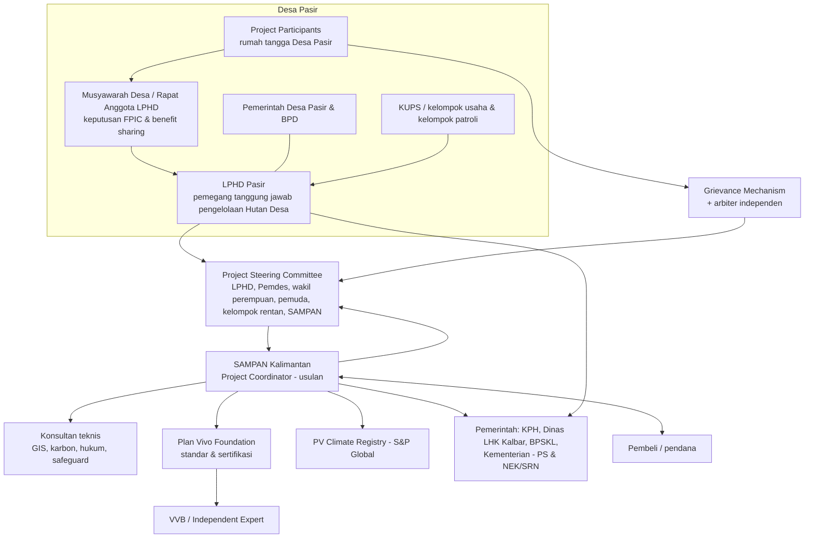
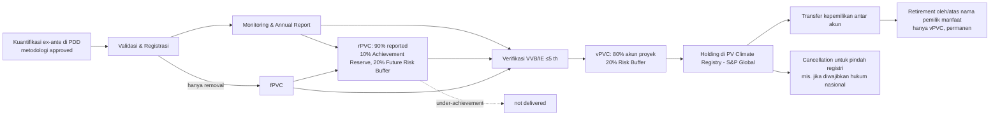

# VOLUME III — TECHNICAL PROJECT DEVELOPMENT

**Pasir Village Forest Community Carbon Project** · Tanggal acuan: 20 Oktober 2026
Kode klasifikasi: **[CR]** Confirmed Requirement · **[RP]** Recommended Practice · **[PSA]** Project-Specific Assumption · **[OCR]** Official Clarification Required · **[PRR]** Potential Regulatory Risk

---

## Bab 12 — Methodology Selection and Applicability

### 12.1 Daftar metodologi, modul, dan tool PV Climate per 20/10/2026 (laman resmi)

**Approved Methodologies [CR]**

| Kode | Nama | Versi | Active from | Cakupan ringkas |
|---|---|---|---|---|
| PM001 | Agriculture & Forestry Carbon Benefit Assessment Methodology | 1.0 | 09/11/2023 | Modular; intervensi di lahan hutan, pertanian, padang rumput: agroforestri, perubahan budidaya, ternak, A/R, **forest restoration, forest protection, improved forest management**. Berlaku untuk "all types of forest, including forested wetlands such as swamp forest and mangroves". **Larangan:** aktivitas proyek tidak boleh mencakup irigasi genangan, **drainase, atau aktivitas lain yang memengaruhi muka air tanah** (PM001 §4.1). Protection/IFM hanya menghasilkan **rPVC/vPVC**; fPVC hanya untuk removal (A/R, restorasi) (PM001 §4.2). |
| PM002 | Methodology for Quantifying Carbon Benefits from Small-Scale Agroforestry (Acorn) | 1.0 | 29/09/2025 | Agroforestri skala kecil berbasis remote sensing |

**Approved Modules [CR]** — PU001 V1.1 (removals dari carbon pools; A/R, restorasi, agroforestri), **PU002 V1.0 (emisi dari carbon pools — forest protection)**, PU003 V1.0 (emisi dari sumber emisi), **PU004 V1.0 (leakage)**, **PU005 V1.1 (uncertainty)**, PU006–PU009 (khusus agroforestri Acorn).

**Approved Tools [CR]** — PT001 V2.1 (SHAMBA, tanah pertanian/agroforestri), **PT002 V2.0 (Estimation of carbon benefits from REDD in community managed forest)**, PT003 V1.0 (penggunaan model tervalidasi), PT004 V1.0 (identifikasi lahan terdegradasi), PT005–PT006 (agroforestri Acorn).

**Methodology pipeline — BELUM APPROVED, tidak boleh dipakai untuk PDD [CR, PM §3–4]** (metodologi/modul mangrove di bawah ini **tidak relevan** bagi Pasir karena tidak ada mangrove — dicantumkan hanya untuk kelengkapan register):
Coastal Blue Carbon Methodology (PM00X draft v0.7), **Mangrove Conservation Module** (PU00A draft v0.9), **Simplified Mangrove Restoration Module** (PU00B draft v0.9), Tool emisi akibat kanal di mangrove (PT00A draft), serta concept notes: tree diameter growth, rangelands, baseline/additionality significance testing tool, soil organic carbon, harvested wood products, **Logged to Protected Forest**.

### 12.2 Uji applicability PT002 (jalur utama untuk Protection) [CR]

PT002 §4.1 — dapat dipakai bila **semua** terpenuhi:
- diterapkan pada **community managed forest**;
- sebagian besar variasi biomassa pohon dijelaskan oleh **tipe hutan**;
- faktor utama driver deforestasi/degradasi dipakai untuk mendefinisikan **strata hutan**.

**Tidak dapat** dipakai bila:
- baseline mencakup **deforestasi terencana** yang terdokumentasi dalam dokumen perencanaan/pengelolaan lahan; **atau**
- baseline mencakup **effective community management**.

Ketentuan prosedural: wajib **reference region** (mencakup ≥2× luas tiap tipe & klasifikasi hukum hutan di project area, dengan driver serupa, project area tidak termasuk), **leakage area**, **reference period**; hanya untuk rPVC/vPVC.

**Implikasi bagi Pasir [PSA + PRR]:**
1. Hutan Desa berstatus "community managed" — memenuhi syarat dasar.
2. Karena persetujuan PS sudah ada sejak 2019, Plan Vivo dan validator akan menguji apakah baseline sudah berisi "effective community management". Bila data tutupan lahan 2019–2026 menunjukkan **tidak ada** kehilangan hutan di areal Hutan Desa sementara di reference region ada, argumen bahwa pengelolaan saat ini tidak efektif akan lemah → **potensi tidak eligible untuk PT002**.
3. Bila RTRW/rencana lain mendokumentasikan alokasi konversi (mis. perkebunan, kawasan industri, infrastruktur di Mempawah) di dalam areal — PT002 tidak dapat dipakai untuk bagian tersebut (dan juga menimbulkan isu legalitas).
4. Cek apakah areal punya cukup luasan hutan serupa di sekitar (reference region 2×) — untuk Hutan Desa berukuran kecil, menemukan reference region yang setara bisa sulit.

### 12.3 Methodology Applicability Matrix

| Intervensi | Potensi metodologi | Status persetujuan | Syarat applicability kunci | Kebutuhan data | Kesesuaian untuk Pasir | Risiko |
|---|---|---|---|---|---|---|
| Avoided deforestation (hutan mineral/rawa) | PM001 + PU002 + PT002 + PU004 + PU005 (+PU003) | **Approved** | Lihat §12.2 | Peta tutupan lahan multi-waktu, strata, plot biomassa, reference region, leakage area | **Paling menjanjikan bila** areal berupa hutan dengan ancaman nyata & pengelolaan saat ini belum efektif [PSA] | Pengecualian "effective community management"; volume kredit kecil bila areal kecil |
| Avoided degradation | Sama (PT002 mencakup deforestasi **dan** degradasi) | Approved | Sama | + data degradasi (kerapatan tajuk, plot berulang) | Mungkin [PSA] | Degradasi sulit dideteksi citra resolusi menengah |
| Konservasi hutan alam (tanpa ancaman) | Tidak ada jalur kredit | — | Tidak additional | — | **Tidak creditable** bila tidak ada ancaman | — |
| ~~Mangrove conservation~~ — **Not Applicable (tidak ada mangrove di Pasir)** | (a) PM001+PU002+PT002; (b) Mangrove Conservation Module PU00A | (a) **Approved**, kecocokan metodologis untuk mangrove **[OCR]**; (b) **Pipeline – belum approved** | (a) syarat PT002; (b) syarat PM00X + PU00A (tanpa alat berat, tanpa panen selektif, dst.) | Strata mangrove, biomassa (alometri mangrove), driver (konversi tambak, abrasi, penebangan) | **Tergantung konfirmasi Plan Vivo** apakah PT002 dapat dipakai untuk mangrove atau harus menunggu PU00A | Karbon tanah mangrove (pool terbesar) kemungkinan tidak terkuantifikasi memadai dengan PT002 → konservatif/kecil; risiko perubahan versi metodologi |
| ~~Mangrove restoration~~ — **Not Applicable** | (a) PM001+PU001; (b) Simplified Mangrove Restoration Module PU00B | (a) Approved [kecocokan **OCR**]; (b) **Pipeline** | PR: tidak ada konversi ekosistem alami 10 th terakhir; spesies asli; tidak ada perubahan hidrologi (PM001) | Peta lahan terbuka/terdegradasi, sejarah tanam (BPDAS dll.), survival plot | Mungkin untuk areal bekas abrasi/tambak terbengkalai **[PSA]** | **Additionality**: penanaman mangrove oleh program pemerintah/swasta sebelumnya (dilaporkan ±35 ha di pesisir Desa Pasir) **tidak boleh diklaim**; pemulihan hidrologi tambak = memengaruhi muka air → dilarang PM001 |
| Peatland protection (cegah drainase/kebakaran) | PM001+PU002+PT002 untuk biomassa **di atas** tanah | Approved (biomassa saja) | Tidak boleh ada aktivitas yang memengaruhi muka air tanah | Peta KHG & kedalaman gambut | Biomassa saja bisa; emisi gambut (oksidasi/kebakaran) — kuantifikasi **[OCR]** | Kredit jauh di bawah potensi riil; aktivitas sekat kanal **tidak** boleh dalam proyek PM001 |
| **Peatland restoration / rewetting** | Tidak ada | **Tidak ada jalur approved** | PM001 melarang aktivitas yang memengaruhi muka air tanah | — | **Tidak creditable** saat ini di PV Climate | Butuh metodologi baru (concept note → MAP) |
| Assisted natural regeneration (ANR) | PM001 + PU001 (+PU003/PU004/PU005), PT004 | Approved | Lahan terdegradasi; tidak ada pembukaan/konversi 10 (s.d. 15) th sebelum intervensi (PR §3.8 Guidance) | Peta degradasi, plot pertumbuhan, model | Mungkin [PSA] | Volume kecil; perlu bukti degradasi (PT004) |
| Sustainable forest management / IFM | PM001 (IFM) — modul spesifik "Logged to Protected Forest" masih concept note | Sebagian (kerangka approved; modul spesifik **pipeline**) | Ada baseline penebangan legal | Rencana tebang, data volume | **Tidak relevan** untuk Hutan Desa tanpa izin pemanfaatan kayu [PSA] | — |
| Agroforestri | PM001 + PU001 / PM002 + PU006–PU009 / PT001 | Approved | Pertanian skala kecil; PT005: tidak ada deforestasi 10 th | Data kebun, biomassa | Hanya bila ada lahan garapan di Project Region di luar hutan [PSA] | Hutan Desa = kawasan hutan; agroforestri di dalamnya harus sesuai RKHD |
| Intervensi lain (mis. ekowisata, perikanan) | Tidak ada | — | Bukan intervensi karbon | — | Hanya sebagai **livelihood benefit** | — |

### 12.4 Rekomendasi jalur metodologi (bersyarat)

1. **Jalur utama (jika areal dominan hutan dengan ancaman nyata):** *Protection* dengan **PM001 + PU002 + PT002 + PU004 + PU005** (+PU003 bila ada sumber emisi), ditambah *Restoration* dengan **PM001 + PU001** untuk areal terdegradasi yang memenuhi syarat.
2. **Mangrove: tidak relevan** — tim proyek mengonfirmasi tidak ada mangrove di Desa Pasir, sehingga Pasir **tidak bergantung pada metodologi pipeline** mana pun. Ini menyederhanakan jalur: semua intervensi kandidat memakai elemen yang sudah approved (PM001, PU001–PU005, PT002, PT004).
3. **Jika areal dominan gambut dengan ancaman drainase/kebakaran:** hanya biomassa yang bisa dikreditkan di PV Climate saat ini; pertimbangkan apakah nilai ekonominya memadai.
4. **Metodologi baru** (concept note USD 350 + asesmen variabel + biaya panel MAP; indikatif 2+4+4+3 minggu review tanpa waktu respons; minimal 4 minggu konsultasi publik) **tidak direkomendasikan** sebagai jalur pertama bagi proyek tunggal skala kecil.

### 12.5 Investigasi wajib sebelum rekomendasi final [CR+RP]
1. Peta areal Hutan Desa resmi (SK) dan klasifikasi tutupan & tanah (gambut/mineral; kedalaman gambut bila ada).
2. Analisis perubahan tutupan 2010–2026 di areal & reference region kandidat.
3. Identifikasi driver dan agen deforestasi/degradasi (wawancara, timeline historis).
4. Bukti efektivitas pengelolaan LPHD sejak 2019 (patroli, RKT, laporan).
5. Sejarah program rehabilitasi/restorasi di areal (RHL BPDAS, restorasi gambut, CSR).
6. Rencana tata ruang (RTRW Kab. Mempawah, RZWP3K Kalbar) di areal & sekitar.
7. Estimasi orde besaran Carbon Benefit (untuk mengetahui micro- vs macroscale dan kelayakan finansial).

---

## Bab 13 — Institutional and Community Governance

### 13.1 Fakta vs usulan

| Elemen | Status |
|---|---|
| LPHD Pasir sebagai lembaga pengelola Hutan Desa berdasarkan SK.10885/2019 | **Fakta** (nomor SK; isi belum diperiksa) |
| SAMPAN Kalimantan sebagai organisasi fasilitator | **Fakta** (per TOR) |
| Perjanjian kerja sama LPHD–SAMPAN | **Dalam persiapan** |
| SAMPAN sebagai Project Coordinator | **Usulan** |
| Forum/Steering Committee proyek | **Usulan** |
| Rekening khusus proyek, audit tahunan | **Usulan** (wajib PR §5.5 setelah ada pendapatan PVC) |

### 13.2 Diagram struktur kelembagaan (usulan)

### 13.3 Roles and Responsibilities Matrix

| Aktor | Peran utama | Hak/kewenangan | Kewajiban |
|---|---|---|---|
| LPHD Pasir | Pengelola Hutan Desa; wakil Project Participants | Hak kelola sesuai SK; persetujuan atas desain, PDD, Project Agreement, benefit sharing | Melaksanakan intervensi, monitoring lapangan, kepatuhan RKHD |
| Pemerintah Desa Pasir | Pembina LPHD; penyelenggara musyawarah desa | Pengesahan Perdes/SK terkait | Dukungan administrasi; tidak boleh menguasai dana partisipan di luar mekanisme yang disepakati |
| Project Participants (rumah tangga) | Pelaksana intervensi & penerima manfaat | FPIC; akses GRM; menerima salinan Project Agreement | Mematuhi Land Management Plan |
| SAMPAN Kalimantan | Project Coordinator (usulan) & fasilitator | Mandat tertulis untuk koordinasi, pengajuan, administrasi registry & penjualan **sejauh diberikan** dalam perjanjian | 13 fungsi PR §2.2; audit keuangan; pelaporan tahunan |
| Konsultan teknis | GIS, karbon, hukum, safeguard | — | Kualitas & independensi data |
| Pendana | Pembiayaan pengembangan | Hak sesuai kontrak (tidak boleh melampaui hak partisipan) | Memenuhi syarat kontrak |
| Calon pembeli | Pembelian PVC | Hak atas PVC setelah transfer di registry | Klaim sesuai aturan (retire hanya vPVC) |
| Plan Vivo | Pemilik standar | Review PIN/PDD, keputusan registrasi, suspend | Sesuai Procedures Manual |
| VVB/IE | Auditor | Menerbitkan temuan | Independen |
| S&P Global | Penyedia registry | Due diligence akun | Mencatat issuance/transfer/retirement |
| Kementerian/Dinas/KPH/BPSKL | Regulator | Persetujuan/registrasi/otorisasi | — |

### 13.4 RACI Matrix (R=Responsible, A=Accountable, C=Consulted, I=Informed)

| Aktivitas | LPHD | Pemdes | Partisipan | SAMPAN | Konsultan | Pemerintah | Plan Vivo |
|---|---|---|---|---|---|---|---|
| Keputusan memulai proyek (FPIC i) | A/R | C | R (memutuskan) | C (memfasilitasi) | I | I | I |
| Penetapan Project Coordinator & PKS | A | C | C | R | C (hukum) | I | I |
| Data spasial & tenurial | C | C | C | A | R | C | — |
| Penyusunan PIN | C | I | C | A/R | R | I | — |
| Submission PIN & korespondensi | C | I | I | A/R | — | — | R (review) |
| Notifikasi otoritas | R (co-sign) | C | I | A/R | — | I | — |
| Desain intervensi (partisipatif) | R | C | R | A | C | C | — |
| Benefit Sharing Mechanism | A (persetujuan) | C | R (masukan) | R (draf) | C | C | I |
| Project Agreement | A | C | R | R | C | — | I |
| Carbon accounting & PDD | C | I | I | A | R | — | — |
| Monitoring lapangan | R | I | R | A | C | — | — |
| Pengelolaan registry & penjualan | C (persetujuan tata kelola) | I | I | A/R | — | C (otorisasi) | I |
| Distribusi pendapatan | A/R (penerima atas nama desa — **usulan**) | C | I | R (penyalur) | — | — | I |
| Audit keuangan | C | I | I (public audit) | A | R (auditor) | — | I |
| GRM | R | C | — | A | — | — | I |

### 13.5 Required Legal Documentation Matrix

| Dokumen | Para pihak | Isi kunci | Kapan |
|---|---|---|---|
| BA Musyawarah LPHD/Desa — keputusan mempertimbangkan proyek (FPIC i) | LPHD, warga | Persetujuan mempertimbangkan; mandat menjajaki | Sebelum PIN |
| Perjanjian Kerja Sama / MoU LPHD–SAMPAN | LPHD, SAMPAN (diketahui Kades) | Peran, ruang lingkup, **tidak ada pengalihan hak kelola**, hak & batas SAMPAN mewakili, kerahasiaan data, exit/termination, penyelesaian sengketa, larangan menjual tanpa persetujuan tata kelola | Sebelum PIN |
| Surat Kuasa/Mandat khusus pengajuan PIN | LPHD → SAMPAN | Kewenangan mengajukan PIN & korespondensi | Sebelum PIN |
| Pernyataan persetujuan Project Coordinator (Annex 2) | PC | Bila pemohon ≠ PC | PIN |
| Bukti registrasi SAMPAN sebagai "mitra atau pendamping teregistrasi" | SAMPAN – Kementerian Kehutanan | Wajib untuk pemegang PS yang berdagang karbon (Permenhut 6/2026 Ps. 6(2), 13(1)(b)) | Dimulai pra-PIN; wajib sebelum pencatatan DPP |
| Pencatatan DPP & persetujuan Menhut penerbitan non-SPE GRK | LPHD/SAMPAN – Kemenhut | Permenhut 6/2026 Ps. 20–24 (persetujuan berlaku 6 bulan) | PDD → pra-issuance |
| Surat pemberitahuan ke otoritas | SAMPAN/LPHD → instansi | Intervensi & perkiraan manfaat karbon | PIN (Annex 5) & PDD (Annex 15) |
| Dokumen registrasi/izin karbon nasional (SRN-PPI dll.) | Pemegang PS/pengembang | Sesuai regulasi berlaku | Lihat Vol. I Bab 5 |
| Project Agreement(s) | PC – Project Participants/LPHD | Wajib PR §3.18: estimasi karbon tahunan setelah buffer, hak PC menjual PVC atas nama partisipan, larangan kredit ganda, tidak mengurangi hak lahan, bahasa pilihan, GRM, durasi | PDD |
| Benefit Sharing Mechanism (draf & final) | Disepakati partisipan | ≥60% ke partisipan & local stakeholders | PDD |
| MoU dengan instansi penegak hukum (bila patroli didukung pemerintah) | PC – instansi | Rujukan safeguard Plan Vivo | PDD (PR §3.9.9) |
| MoU Plan Vivo | PC – Plan Vivo | Kewajiban registrasi | Setelah validasi |
| Akun registry S&P Global | PC | KYC | Setelah registrasi |
| ERPA/Offtake | PC (atas mandat) – pembeli | Lihat Vol. IV | Setelah syarat hukum terpenuhi |

### 13.6 Governance Risk Assessment

| Risiko | Likelihood | Dampak | Mitigasi |
|---|---|---|---|
| Ambiguitas siapa pemilik hak menjual PVC | Tinggi | Tinggi | PKS + Project Agreement + kajian hukum; konfirmasi Plan Vivo |
| Elite capture di LPHD/desa | Sedang | Tinggi | Representasi perempuan & rentan di SC; public audit tahunan (Toolkit Tool 16); rekening terpisah |
| Pergantian kepala desa/pengurus LPHD | Sedang | Sedang | Perjanjian mengikat kelembagaan, bukan individu; Perdes |
| Ketergantungan pada SAMPAN | Sedang | Tinggi | Rencana penguatan kapasitas & exit/handover |
| Konflik kepentingan fasilitator–pengembang | Sedang | Sedang | Transparansi biaya koordinasi (≤40%) dan fee SAMPAN |
| Ketidakpatuhan regulasi PS (mis. kerja sama tanpa persetujuan yang disyaratkan) | **[PRR]** | Tinggi | Konsultasi BPSKL/Dinas sebelum menandatangani |

### 13.7 Prosedur pengambilan keputusan (usulan)
1. Keputusan strategis (lanjut/tidak, penetapan PC, persetujuan PIN/PDD, Benefit Sharing, kontrak penjualan): **Musyawarah LPHD/Desa** dengan kuorum dan keterwakilan perempuan minimal yang disepakati; dicatat dalam BA.
2. Keputusan operasional: Steering Committee (rapat triwulanan).
3. Keputusan teknis harian: Project Coordinator, dilaporkan ke SC.
4. Semua kontrak penjualan wajib persetujuan SC + BA musyawarah sebelum ditandatangani.

---

## Bab 14 — FPIC and Safeguards

### 14.1 FPIC Requirement Matrix [CR — PR §2.6]

| Persyaratan | Isi | Kapan | Bukti |
|---|---|---|---|
| 2.6.1 | Proses yang memungkinkan negosiasi syarat desain, implementasi, monitoring, evaluasi | Seluruh siklus | Rencana FPIC, notulen negosiasi |
| 2.6.2 | Memenuhi/melampaui hukum nasional & standar internasional (UNDRIP, ILO 169 bila relevan) | Desain proses | Analisis hukum FPIC |
| 2.6.3 | Proses & timeline ditentukan pemegang hak; wakil dipilih sendiri; libatkan perempuan & rentan | Sebelum tahap i | BA penetapan proses & wakil |
| 2.6.4 | Keputusan kolektif memberi/menolak consent pada: (i) mempertimbangkan; (ii) terlibat desain; (iii) implementasi | i: pra-PIN (ditanya Annex 4 §C); ii: awal desain; iii: sebelum Project Agreement/PDD | BA keputusan tiap tahap |
| 2.6.5 | Consent sebelum kegiatan & dikonfirmasi ulang berkala | Berkala (mis. tiap verifikasi & ekspansi) | Jadwal re-konfirmasi |
| 2.6.6 | Informasi akurat, tepat waktu, cukup, sesuai budaya, termasuk risiko & dampak negatif | Sebelum tiap keputusan | Materi info (Bahasa Indonesia/lokal), bukti distribusi |
| 2.6.7 | Isu consent dapat diangkat kapan saja lewat GRM | Sepanjang proyek | Prosedur GRM |

**Pembedaan consent [CR+RP]:** consent tahap (i) **tidak** sama dengan consent untuk implementasi, apalagi untuk kontrak penjualan. Consent untuk Project Agreement (PR §3.18.1) dan untuk Benefit Sharing (PR §3.16.1) adalah keputusan tersendiri.

### 14.2 Pre-PIN Safeguard Checklist
- [ ] Stakeholder analysis (Tool 1) selesai — PR 2.1.1.
- [ ] Identifikasi masyarakat adat/lokal pemegang hak + struktur keputusan + keterlibatan perempuan — PR 2.1.2.
- [ ] Daftar sengketa lahan/sumber daya masa lalu & berjalan — PR 2.1.3.
- [ ] Kerangka Stakeholder Engagement Plan (boleh draf) — PR 2.5.1.
- [ ] Semua stakeholder telah diberi informasi proyek dalam format mudah diakses — PR 2.5.2.
- [ ] Analisis persyaratan FPIC nasional & internasional.
- [ ] Wakil pemegang hak teridentifikasi; proses & timeline keputusan dipahami.
- [ ] Consent tahap (i) terdokumentasi.
- [ ] Status GRM (ada/akan dibentuk) dideskripsikan.
- [ ] Exclusion List & kuesioner E&S Section B terisi.

### 14.3 Stakeholder Consultation Documentation Checklist
Untuk setiap pertemuan: undangan (tanggal kirim); agenda; materi (bahasa); daftar hadir **terpilah gender/usia/kelompok** (dengan persetujuan penggunaan data); notulen (pertanyaan, kekhawatiran, jawaban); keputusan; foto (dengan izin); tindak lanjut & bukti umpan balik ke peserta; tanda tangan notulis & perwakilan peserta; penyimpanan di folder 05_Konsultasi (Vol. V Bab 26).

### 14.4 GRM Preparation Checklist [CR — PR §3.17]
- [ ] Kanal yang mudah diakses (kotak aduan, nomor WA, petugas desa, melalui perempuan pendamping).
- [ ] Sesuai budaya; bisa anonim.
- [ ] Mencakup insiden sosial, lingkungan, budaya, ketidakpatuhan Project Agreement, isu consent.
- [ ] Registrasi & dokumentasi setiap keluhan; tenggat respons.
- [ ] Penyelesaian berjenjang: musyawarah para pihak → SC → **arbiter independen** yang diidentifikasi (wajib 3.17.3).
- [ ] Dicantumkan di setiap Project Agreement (3.17.4, 3.18.8).
- [ ] Dilaporkan di Annual Report (PR 4.9.3).
- [ ] Rujukan ke mekanisme keluhan Plan Vivo (laman governance) untuk keberatan terhadap Plan Vivo.

### 14.5 Community Benefit-Sharing Preparation Matrix [CR — PR §3.16]

| Elemen wajib | Pertanyaan yang harus dijawab partisipan | Bukti |
|---|---|---|
| ≥60% pendapatan PVC (setelah pungutan/pajak negara) langsung bermanfaat bagi partisipan & local stakeholders (boleh <60% per issuance asalkan total periode kredit ≥60%) | Berapa porsi tunai vs program kolektif vs in-kind? | Draf BSM v1, v2, final |
| Proporsi untuk partisipan, PC, pihak lain (pemerintah, mitra teknis) | Berapa untuk biaya koordinasi & MRV (pedoman ≤40%)? | Tabel alokasi |
| Bagaimana & kapan manfaat diterima | Jadwal, mekanisme pembayaran, rekening | SOP penyaluran |
| Dependensi & target progress indicators, konsekuensi bila target tak tercapai | Aturan bila patroli tidak berjalan dll. | Lampiran Project Agreement |
| Proses iteratif: draf & final dibagikan; bukti umpan balik ditanggapi | — | Notulen + matriks umpan balik |
| Konsisten dengan hukum nasional | Apakah ada ketentuan pembagian manfaat/PNBP/pajak? | Vol. I Bab 5 |

### 14.6 Social Safeguard Action Plan (ringkas)

| No | Aksi | Tahap | PIC | Output |
|---|---|---|---|---|
| 1 | Stakeholder analysis & social mapping | Pra-PIN | SAMPAN | Laporan |
| 2 | FPIC tahap (i) | Pra-PIN | LPHD+SAMPAN | BA |
| 3 | Kuesioner E&S Annex 4 | PIN | SAMPAN | Annex 4 |
| 4 | E&S Assessment (tailored ESA; ESIA bila high risk) | PDD | Konsultan safeguard | Annex 10 PDD |
| 5 | ESMP (bila moderate risk) + Stakeholder Engagement Plan + GRM | PDD | SAMPAN | Annex PDD |
| 6 | FPIC tahap (ii) & (iii) | PDD | LPHD+SAMPAN | BA |
| 7 | BSM iteratif | PDD | SC | BSM final |
| 8 | Monitoring indikator livelihood/ekosistem ≥ tiap 5 tahun | Implementasi | LPHD+SAMPAN | Annual Report |

---

## Bab 15 — PIN-to-PDD Development

### 15.1 Struktur PDD Template V5.7 [CR]
General Information (Project Interventions; Management Rights) → Stakeholder Engagement (Stakeholder Analysis; Coordination; Participants; Participatory Design; Consultation; FPIC) → Project Design: Baselines (Baseline Scenario; Carbon; Livelihood; Ecosystem), Theory of Change (Project Logic), Technical Specification (Activities; Additionality; Carbon Benefits), Risk Management (E&S Safeguards; Achievement; Reversal; Leakage; Double Counting), Agreements (Land Management Plans; Crediting Period; Benefit Sharing; Grievance; Project Agreements) → Monitoring & Reporting (Indicators; Monitoring Plan; Progress/Carbon/Livelihood-Ecosystem Monitoring; Annual Report; Record Keeping) → Governance & Administration (Governance; Equal Opportunities; Legal Compliance; Financial Plan; Financial Management) → **17 Annex** (Boundaries; Registration Certificate & Partner Agreements; Initial Project Areas; Participatory Design; Initial FPIC; **Carbon Calculations Spreadsheet**; Technical Specifications; Exclusion List; E&S Screening Report; **E&S Assessment Report**; Land Management Plans; Project Agreements; Monitoring Plan; Project Database; **Authority Engagement and Approvals**; Financial Plan; AI Disclosure).

### 15.2 PIN-to-PDD Gap Analysis

| Area teknis | Kebutuhan PIN | Kebutuhan PDD | Studi tambahan | Bukti | Tim |
|---|---|---|---|---|---|
| Batas proyek | Peta indikatif | Batas final, KML publik | Delineasi lapangan + GPS | SHP/KML, BA batas | GIS |
| GIS & tutupan lahan | Indikatif | Analisis sesuai PT002/PU001 (reference region, reference period, akurasi peta) | Klasifikasi multi-waktu + uji akurasi | Peta, matriks akurasi | GIS/karbon |
| Baseline scenario | Naratif | Per Project Area mengikuti metodologi | Analisis driver | Laporan | Karbon/sosial |
| Carbon baseline & benefits | Kualitatif/orde besaran | Estimasi tahunan sepanjang Project Period, setelah leakage, uncertainty, buffer | Inventarisasi plot, faktor emisi | Spreadsheet (Annex 6) | Karbon |
| Additionality | Barrier analysis awal | Barrier + **Regulatory Surplus** per intervensi | Kajian hukum PS | Analisis | Hukum/karbon |
| Leakage | — | PU004 (estimasi langsung atau diskon) | Identifikasi leakage area | Peta | Karbon |
| Permanence / reversal | — | Risiko ≥50 th; mitigasi; buffer 20% | Analisis risiko (kebakaran, banjir/kekeringan, kebijakan) | Matriks risiko | Karbon/safeguard |
| Double counting | Identifikasi awal | Bukti tidak ada overlap; status pelaporan di program pemerintah | Cek registri | Surat/registri | Hukum |
| Technical Specification | — | Per intervensi: aktivitas, input, Carbon Indicators | — | Annex 7 | Karbon |
| Land Management Plans | — | Per partisipan/kelompok | Pemetaan partisipatif | Annex 11 | Sosial |
| Project Agreements | — | Ditandatangani setelah FPIC iii | — | Annex 12 | Hukum/sosial |
| Benefit Sharing | Disinggung | Mekanisme final + bukti iterasi | Konsultasi | BSM | SC |
| Safeguards | Screening | ESA (+ESMP), SEP, GRM | ESA | Annex 9–10 | Safeguard |
| Monitoring plan | — | Semua indikator (progress, karbon, livelihood, ekosistem) | — | Annex 13 | Semua |
| Keuangan | Sumber dana pengembangan | Biaya penuh implementasi & mitigasi risiko, konsisten dengan BSM | Model finansial | Annex 16 | Keuangan |
| Legal | Notifikasi | Bukti diinformasikan + persetujuan bila diwajibkan | Proses perizinan nasional | Annex 15 | Hukum |

### 15.3 Studi yang harus dimulai lebih awal (critical path)
1. Analisis tutupan lahan historis & reference region (menentukan eligibilitas PT002).
2. Klarifikasi hukum hak karbon/otorisasi (menentukan siapa boleh menjual).
3. Inventarisasi biomassa (musim, akses pasang-surut).
4. FPIC berlapis & BSM iteratif (butuh beberapa siklus musyawarah).
5. Klarifikasi perlakuan emisi tanah gambut dengan Plan Vivo (bila areal bergambut).

---

## Bab 16 — Validation and Certification

### 16.1 Urutan formal (Macroscale = ≥10.000 tCO2e/th wajib VVB; Microscale <10.000 tCO2e/th boleh jalur IE) [CR — PM §4–6; V&V Req §1]

> Catatan: dokumen resmi memakai ambang yang sedikit berbeda (PM: "less than 10,000"; CF: "less than or equal to 10,000 PVCs"; V&V Req: "≥10,000 = macroscale") — konfirmasi bila estimasi mendekati ambang **[OCR]**.

| Tahap | Persyaratan | Lead | Reviewer independen | Deliverable | Gate | Durasi indikatif |
|---|---|---|---|---|---|---|
| 1. Pemilihan metodologi | Semua metodologi harus **approved** sebelum PDD | PC | — | — | — | — |
| 2. PDD submission | Template V5.7; email; bayar fee PDD review + V&V coordination; hanya untuk proyek pipeline | PC | — | PDD + annex | Pembayaran | — |
| 3. PDD screening | Kelengkapan & konsistensi; CAR/NIR; resubmit ≤6 bln; maks 3 putaran | Plan Vivo | — | Screening report | CAR ditutup | 6 mg + 4 mg/putaran |
| 4. Konsultasi publik | PDD dipublikasikan 4 minggu | Plan Vivo | Publik | Feedback | — | 4 mg |
| 5a. PDD review (macro) | Review terhadap PR + review teknis ahli metodologi | Plan Vivo | Ahli metodologi | PDD review report | CAR/NIR ditutup saat validasi | 8 mg |
| 5b. Validasi (macro) | Kontrak VVB approved → VVB tanda tangan ToR → audit plan disetujui Plan Vivo → site visit (setelah konsultasi publik selesai) → CAR/NIR/FAR (maks 3 FAR) → laporan disetujui Plan Vivo | PC + VVB | **VVB** | Validation report | Approval Plan Vivo | Tergantung VVB |
| 5′. Validasi (micro) | Review PDD (8 mg) + review teknis → ToR IE → proposal site visit disetujui → kontrak IE → site visit → laporan ≤1 tahun setelah site visit | Plan Vivo + IE | **IE** | Validation report | Approval Plan Vivo | 8+5+4+4 mg (tanpa waktu respons) |
| 6. Registrasi | **MoU** dengan Plan Vivo → **registration certificate** + nomor registrasi unik → publikasi PDD/validation report/KML | PC | — | Sertifikat | MoU | — |
| 7. Registry account | Akun koordinator (due diligence S&P Global) → akun proyek (PDD approved, validation report, registration certificate) | PC | S&P Global | Akun | KYC | — |
| 8. Annual Report pertama | Mulai dari Start Date, berakhir ≤12 bln setelah registrasi; kemudian tiap 12 bln, berkesinambungan | PC | Plan Vivo review | AR + permintaan issuance | Approval AR | 4 mg + 2 mg |
| 9. Verifikasi | ≤5 tahun setelah validasi; periode verifikasi ≤5 th | PC + VVB/IE | VVB/IE | Verification report | Approval Plan Vivo | Tergantung VVB |
| 10. Kepatuhan berkelanjutan | Update PDD (baseline/logic/techspec ≤10 th; additionality & double counting ≤5 th) | PC | Plan Vivo | PDD update | — | — |

Batas waktu kritis [CR]: PDD ≤3 th setelah PIN approval; validasi ≤3 th setelah PDD submission; Start Date ≤5 th sebelum selesainya validasi.

**Label CCP/CORSIA [CR]:** hanya untuk vPVC, wajib verifikasi oleh **VVB** (jalur microscale IE tidak eligible), dan Project Period ≥40 tahun dengan metodologi yang disetujui CCP.

---

## Bab 17 — Monitoring and Verification

| Aspek | Persyaratan [CR] | Implikasi Pasir |
|---|---|---|
| Progress Indicators | SMART; target & corrective action; ringkasan di setiap AR | Mis. jumlah patroli, luas restorasi, survival |
| Carbon Indicators | Sesuai metodologi; dimonitor sepanjang crediting period | Peta tutupan berkala; plot |
| Livelihood & Ecosystem Indicators | ≥ tiap 5 th; terpilah gender; terkait SDGs | Survei rumah tangga sampel |
| Annual Report | Tiap 12 bln, diajukan ≤12 bln setelah akhir periode; terlambat → fee USD 100; >24 bln → suspend | Siapkan kapasitas pelaporan |
| Record keeping | Database Project Agreement, LMP, lokasi, monitoring, PVC; dapat diakses verifier | Sistem dokumen Vol. V Bab 26 |
| Audit keuangan | Tahunan oleh auditor independen bersertifikat, ≤12 bln setelah tahun buku | Anggarkan biaya KAP |
| Verifikasi | ≤ tiap 5 th; final verification di akhir crediting period | Siklus biaya VVB/IE |

---

## Bab 18 — Registry and Credit Issuance

### 18.1 Apa itu PVC [CR — PM §14]
Satu PVC merepresentasikan Carbon Benefit 1 tCO2e (tCO2e adalah satuan metodologi). Tiga jenis:

| Jenis | Kapan diterbitkan | Dapat dialokasikan ke pembeli? | Dapat di-retire? | CCP/CORSIA? | Relevansi Pasir |
|---|---|---|---|---|---|
| fPVC (future) | Saat validasi / saat AR menunjukkan areal ditambahkan; **hanya untuk intervensi removal** | Ya | **Tidak** | Tidak | Hanya untuk komponen restorasi; **tidak** untuk protection/REDD |
| rPVC (reported) | Saat AR menunjukkan Carbon Benefit tercapai (belum diverifikasi) | Ya | **Tidak** | Tidak | Jalur pendanaan awal untuk protection |
| vPVC (verified) | Setelah verifikasi | Ya | **Ya** | Ya (dengan syarat) | Unit akhir untuk klaim offset |

### 18.2 Pengurangan wajib [CR]
- fPVC/rPVC: maksimal **90%** dari Carbon Benefit yang diharapkan (10% **Achievement Reserve**), lalu **20% Future Risk Buffer**.
- vPVC: **20%** ke **Risk Buffer** gabungan.
- Contoh ilustratif (bukan proyeksi Pasir): 1.000 tCO2e terverifikasi → 800 vPVC ke akun proyek, 200 ke Risk Buffer.

### 18.3 Siklus hidup kredit

### 18.4 Jawaban pertanyaan registry

| Pertanyaan | Jawaban | Dasar |
|---|---|---|
| Sistem registri | PV Climate Registry oleh **S&P Global** | PM §6, §6.2 [CR] |
| Pemegang akun | Project Coordinator (akun koordinator → akun proyek); reseller dapat membuka akun (fee USD 800 + 800/th) | PM §6.2; CF [CR] |
| Siapa meminta issuance | Proyek, melalui permintaan issuance bersama AR/verification report; ditinjau Plan Vivo & S&P Global | PM §7, §15.8 [CR] |
| Identifikasi | Nomor seri unik | PM §6.2 [CR] |
| Transfer | Perpindahan kepemilikan manfaat antar pemegang akun di registry | PM Definitions [CR] |
| Retirement | Inaktivasi permanen vPVC untuk klaim | PM Definitions [CR] |
| Pencegahan double issuance/counting | Nomor seri; larangan overlap (PR 3.13); larangan terdaftar di program lain (PR 3.13.5; PM §7); cancellation sebelum pindah registri; CA untuk Article 6/CORSIA | [CR] |
| Ex-ante | fPVC (removal saja) & rPVC (belum diverifikasi) diizinkan; tidak bisa di-retire | PM §14 [CR] |
| Biaya | Issuance **USD 0,40/PVC** (≤50.000 PVC/proyek/tahun), USD 0,35 di atasnya; konversi gratis; biaya akun koordinator S&P Global **[OCR — tidak tercantum di dokumen Plan Vivo]** | CF [CR] |
| Sertifikasi = unit? | **Tidak.** Registrasi tidak otomatis menghasilkan unit; issuance memerlukan AR/verifikasi dan permintaan issuance | PM §6–7 [CR] |
| Issuance ≠ penjualan | Issuance mencatat unit di akun proyek; penjualan adalah transaksi komersial + transfer di registry | [CR] |
| Corresponding Adjustment | Untuk Article 6.2/CORSIA/klaim yang butuh otorisasi: attestation otorisasi dari *national focal point* + Letter of CA Risk Acknowledgement; label CA | PM §15.7; PR 3.13.3 [CR] |
| Pindah registri | Diizinkan bila diwajibkan hukum lokal; PVC dibatalkan dulu di PV Climate Registry | PM §15.6 [CR] — relevan untuk regulasi Indonesia (Vol. I Bab 5) |
