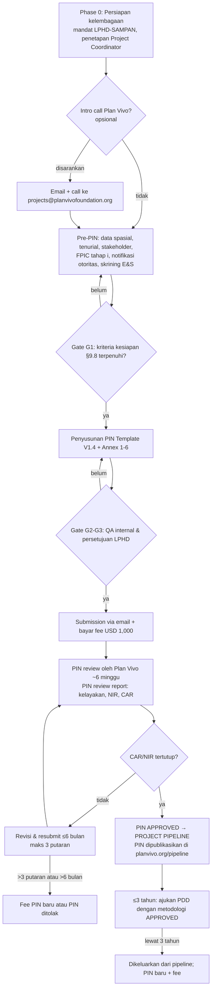

# VOLUME II — PIN DEVELOPMENT DAN SUBMISSION

**Pasir Village Forest Community Carbon Project — Hutan Desa Pasir, Kabupaten Mempawah, Kalimantan Barat**
Tanggal acuan riset: 20 Oktober 2026 · Disusun untuk: SAMPAN Kalimantan & LPHD Pasir

> Kode klasifikasi temuan yang dipakai di seluruh dokumen (lihat `README.md`):
> **[CR]** Confirmed Requirement · **[RP]** Recommended Practice · **[PSA]** Project-Specific Assumption · **[OCR]** Official Clarification Required · **[PRR]** Potential Regulatory Risk

Dokumen acuan utama Volume ini:

| Kode | Dokumen resmi | Versi | Tanggal rilis versi |
|---|---|---|---|
| PIN-T | PV Climate V5 PIN Template | V1.4 | tidak tercantum di dokumen (versi terbaru di laman dokumen per 20/10/2026) |
| PR | PV Climate Project Requirements | V5.7 | 30/04/2026 |
| PM | PV Climate Procedures Manual | V3.9 | 30/04/2026 |
| CF | PV Climate – Costs & Fees (PDF) | tanpa nomor versi | diunduh 20/10/2026 |
| ESRM | Environmental & Social Risk Management in Plan Vivo Projects | V1.0 | Agustus 2024 |

---

## Bab 6 — Pre-PIN Readiness Assessment

### 6.1 Apa yang sebenarnya dinilai pada tahap PIN

**[CR]** PM §2.1–2.2 dan instruksi umum PIN-T: PIN adalah *"initial eligibility check"* — pemeriksaan kelayakan awal terhadap PV Climate V5 Project Requirements. PIN **bukan** dokumen desain final, tetapi wajib menjelaskan (PM §2.1):

1. Rencana *Project Interventions*;
2. *Project Region* dan *Project Areas*, **termasuk hak atas lahan dan hak karbon**;
3. Keterlibatan *Stakeholders* (Project Coordinator, Project Participants, Local Stakeholders lain);
4. Kondisi penggunaan lahan, mata pencaharian, dan ekologi sebelum proyek, serta perkiraan perubahannya tanpa proyek (baseline);
5. *Outputs* dan *Outcomes* yang diharapkan;
6. Hambatan (*barriers*) pelaksanaan intervensi;
7. Risiko lingkungan & sosial serta potensi *Double Counting*;
8. Tata kelola dan administrasi proyek.

**[CR]** PM §2.1: Proyek harus menunjukkan **kapasitas dan keahlian** untuk mengembangkan proyek, serta menyebutkan di mana akan memakai dukungan teknis eksternal. Plan Vivo **tidak** menyediakan pendanaan maupun dukungan teknis selain saran kepatuhan.

**[CR]** PIN-T, Annex 4: Skrining E&S (kuesioner Section A–C) **wajib diisi Project Coordinator dan diserahkan bersama PIN**; Section D (Screening Report) diisi oleh reviewer E&S Plan Vivo.

### 6.2 Status kesiapan Pasir per 20 Oktober 2026 (berdasarkan informasi yang tersedia)

Informasi yang **sudah dikonfirmasi** dalam penugasan ini hanya: nama lokasi, nama LPHD, nomor SK Hutan Desa (SK.10885/MENLHK-PSKL/PKPS/PSL.0/2019), nama organisasi fasilitator, dan pilihan standar. Semua parameter teknis lain berstatus belum terverifikasi.

| Domain kesiapan | Status | Dasar penilaian |
|---|---|---|
| Identitas & legalitas Project Coordinator | Information Required | Belum ada bukti akta/registrasi badan hukum SAMPAN di berkas riset; belum ditetapkan siapa Project Coordinator |
| Hak kelola areal (Hutan Desa) | Partially Ready | SK 2019 tersedia sebagai referensi; salinan SK, peta areal kerja, dan masa berlaku belum diperiksa |
| Hak atas manfaat karbon / penjualan PVC | Information Required + **[PRR]** | Lihat Bab 5 (Vol. I): hak karbon & otorisasi perdagangan diatur negara |
| Batas Project Region / Project Area | Information Required | Belum ada peta digital/shapefile terverifikasi |
| Kelas ekosistem (mangrove / gambut / mineral) | Information Required | Data publik menunjukkan Desa Pasir (Kec. Mempawah Hilir) memiliki kawasan mangrove (Mempawah Mangrove Park) — **belum dipastikan** apakah identik/beririsan dengan areal Hutan Desa |
| Intervensi & metodologi | Information Required | Lihat Bab 12 (Vol. III) |
| Stakeholder analysis | Information Required (sedang berjalan) | Disebut "preliminary stakeholder identification" — belum ada dokumen |
| FPIC tahap 1 ("consider the proposed project") | Information Required | Belum ada notulen/keputusan kolektif yang terdokumentasi |
| Skrining E&S (Annex 4) | Not started | — |
| Notifikasi otoritas (Annex 5) | Not started | — |
| Rencana pendanaan pengembangan | Information Required | — |

**Kesimpulan Bab 6:** Proyek **belum siap** untuk *submission* PIN per 20/10/2026. Proyek **siap untuk memulai penyusunan PIN secara paralel** dengan pengumpulan bukti, dengan target *submission* hanya setelah kriteria kesiapan di §9.8 terpenuhi.

---

## Bab 7 — Complete PIN Preparation Handbook (section-by-section, mengikuti struktur resmi PIN Template V1.4)

### 7.0 Aturan format wajib PIN Template V1.4 [CR]

| Aturan | Isi |
|---|---|
| Format | Tidak boleh mengubah format template; tabel dan kolom tidak boleh dihapus/diubah (boleh menambah baris & lampiran) |
| Font | Calibri 11pt, hitam, regular (non-italic) |
| Angka | Format internasional: pemisah ribuan koma/spasi, **desimal memakai titik** (bukan koma) — perhatikan karena kebiasaan Indonesia terbalik |
| Instruksi | Seluruh teks instruksi & kotak panduan **harus dihapus** dari dokumen final |
| Bahasa | **Bahasa Inggris**; dokumen lampiran berbahasa Indonesia wajib disertai terjemahan lengkap bagian yang relevan |
| Kelengkapan | Semua bagian wajib diisi; tidak boleh menghapus bagian |
| AI | Penggunaan AI boleh, tetapi wajib diungkapkan di **Annex 6 – AI Tool Use Disclosure**, dan Project Coordinator bertanggung jawab penuh atas akurasi. Pekerjaan lapangan & konsultasi partisipatif **tidak boleh** digantikan AI |

> Catatan untuk tim: dokumen panduan ini sendiri disusun dengan bantuan AI. Jika teks dari panduan ini diadopsi ke PIN, cantumkan di Annex 6 dan lakukan verifikasi manusia atas setiap fakta.

### 7.1 Peta struktur resmi PIN Template V1.4

```
OVERVIEW (Project Title, Location, Project Coordinator, Project Area, Project Participants,
          Project Intervention(s), Expected Benefits, Methodology, PIN Version, Date Approved)
1 General Information
   1.1 Project Interventions          (Table 1.1)
   1.2 Project Boundaries             (peta + Table 1.2)
   1.3 Land and Carbon Rights
2 Stakeholder Engagement
   2.1 Stakeholder Identification
   2.2 Project Coordination and Management   (Table 2.2 — 13 fungsi)
   2.3 Project Participants
   2.4 Participatory Design
   2.5 FPIC Process
3 Project Design
   3.1 Baseline Scenario
   3.2 Livelihood Baseline
   3.3 Ecosystem Baseline
   3.4 Project Logic                  (Table 3.4)
   3.5 Additionality                  (Table 3.5 Initial Barrier Analysis)
   3.6 Exclusion List
   3.7 Environmental and Social Screening
   3.8 Double Counting                (Table 3.8 National Legislation)
4 Governance and Administration
   4.1 Governance Structure
   4.2 Legal and Regulatory Compliance
   4.3 Financial Plan
ANNEXES
   Annex 1 Project Boundaries (file geospasial — "optional")
   Annex 2 Registration Certificate (+ pernyataan persetujuan jika pemohon ≠ Project Coordinator)
   Annex 3 Exclusion List (27 butir Ya/Tidak)
   Annex 4 Environmental and Social Screening (Section A–C diisi proyek; D oleh Plan Vivo)
   Annex 5 Notification of Relevant Authorities
   Annex 6 AI Tool Use Disclosure
```

**Pemetaan topik yang diminta TOR ke heading resmi** (heading resmi tidak boleh diganti):

| Topik TOR | Letak di PIN resmi |
|---|---|
| Project identification, participants & organizations | OVERVIEW; 2.2; 2.3; Annex 2 |
| Project description, objectives, intervention activities | OVERVIEW; 1.1; 3.4 |
| Location & boundaries | 1.2; Annex 1 |
| Land eligibility & tenure | 1.3 |
| Carbon benefits | OVERVIEW "Expected Benefits"; 1.1; 3.4 (baris *Carbon Benefit*) |
| Baseline & additionality | 3.1–3.3; 3.5 |
| Methodology selection | OVERVIEW "Methodology" |
| Stakeholders & beneficiaries | 2.1; 2.3 |
| Community engagement | 2.4; 2.5; Annex 4 Section C |
| Environmental & social risks | 3.6; 3.7; Annex 3; Annex 4 |
| Benefit sharing | Tidak ada heading khusus di PIN → disinggung di 4.1/4.3; menjadi wajib penuh di PDD (PR §3.16) |
| Governance | 4.1; 2.2 |
| Financing & implementation | 4.3 |
| Monitoring arrangements | Tidak ada heading khusus di PIN → disinggung di 2.2 (fungsi monitoring/MRV) & 3.4; wajib penuh di PDD (PR §4) |

### 7.2 Panduan per bagian

Format setiap bagian: **Tujuan · Isi wajib · Data & bukti · Tingkat detail · Pendekatan untuk Pasir · Boleh preliminary · Harus final · Kesalahan umum**.

#### OVERVIEW
- **Tujuan:** Ringkasan satu halaman yang dipakai reviewer dan dipublikasikan bila PIN disetujui (PM §2.2).
- **Isi wajib [CR]:** Judul; lokasi (negara, kabupaten/provinsi); nama & kontak Project Coordinator; luas total Project Area (ha) pada awal + rencana ekspansi; ringkasan Project Participants (jumlah individu/rumah tangga) + rencana ekspansi; daftar intervensi dengan kategori **Protection / Restoration / Improved Management**; manfaat karbon, ekosistem, mata pencaharian; metodologi Plan Vivo yang disetujui (atau rencana pengembangan metodologi); versi PIN; tanggal disetujui (diisi setelah approval).
- **Pendekatan Pasir:** Gunakan judul kerja "Pasir Village Forest Community Carbon Project". Lokasi: "Pasir Village, Mempawah Hilir Sub-district [TO BE CONFIRMED], Mempawah Regency, West Kalimantan Province, Indonesia". Methodology: tulis "PM001 (Agriculture & Forestry Carbon Benefit Assessment Methodology) V1.0 with Module PU002 and Tool PT002 [subject to applicability confirmation]" — **hanya jika** hasil skrining Bab 12 mengonfirmasi. Jika areal dominan mangrove, lihat opsi di Bab 12.
- **Boleh preliminary:** luas Project Area (sebutkan "indicative"), jumlah partisipan (estimasi), manfaat karbon (kualitatif atau orde besaran dengan disclaimer).
- **Harus final:** identitas Project Coordinator, kategori intervensi, metodologi yang dirujuk harus berstatus *approved* (bukan pipeline).
- **Kesalahan umum:** menyebut angka tCO2e yang presisi tanpa dasar; menyebut metodologi pipeline (mis. "Coastal Blue Carbon Methodology") seolah sudah disetujui; luas Hutan Desa (SK) dicampur dengan luas Project Area yang layak.

#### 1.1 Project Interventions (Table 1.1)
- **Tujuan:** Menunjukkan bahwa tiap intervensi memberi peningkatan stok karbon/penurunan emisi jangka panjang **dan** dampak positif bagi mata pencaharian serta ekosistem.
- **Isi wajib [CR]:** Satu baris per intervensi: Intervention Type · Project Intervention (deskripsi) · Expected Benefits (iklim, livelihood, ekosistem). PR §1.1.2: manfaat livelihood **tidak boleh hanya** dari penjualan PVC atau upah kerja proyek.
- **Pendekatan Pasir:** Kandidat intervensi (status **[PSA]**, wajib divalidasi dengan data):
  1. *Protection* — perlindungan hutan Hutan Desa dari deforestasi/degradasi (patroli partisipatif, penguatan RKHD/RKT, pencegahan kebakaran bila relevan).
  2. *Restoration* — rehabilitasi areal terdegradasi melalui *assisted natural regeneration* / penanaman spesies asli (mangrove atau spesies hutan rawa/mineral sesuai tipe lahan).
  3. *Improved Management* — hanya jika ada praktik pengelolaan yang terukur karbonnya dengan metodologi yang disetujui.
  Untuk manfaat livelihood non-karbon, identifikasi usaha HHBK/jasa lingkungan (mis. ekowisata mangrove, perikanan pesisir, madu kelulut) **berdasarkan hasil konsultasi**, bukan asumsi.
- **Kesalahan umum:** intervensi "pembangunan ekowisata" ditulis sebagai intervensi karbon; tidak menyebut kategori resmi.

#### 1.2 Project Boundaries (peta + Table 1.2)
- **Isi wajib [CR]:** Peta Project Region, Project Area(s), dan kawasan lindung di dalam/berbatasan; Table 1.2: lokasi, jumlah & luas Project Region, jumlah & luas Project Area, kawasan lindung yang ditetapkan secara hukum. PR §1.2.2: semua batas harus dipetakan. File geospasial di Annex 1 bersifat *optional* pada PIN (wajib pada PDD — KML dipublikasikan setelah registrasi, PM §4.4).
- **Data:** Peta areal kerja dari SK Hutan Desa (lampiran SK), shapefile dari BPSKL Wilayah Kalimantan / Dinas LHK Kalbar / KPH setempat, peta kawasan hutan (SK penunjukan/penetapan kawasan Kalbar), peta KHG (Kesatuan Hidrologis Gambut), peta mangrove nasional, batas desa.
- **Pendekatan Pasir:** Definisikan **Project Region** = wilayah administrasi Desa Pasir (+ area ekspansi potensial, mis. desa tetangga bila ada rencana), dan **Project Area** = bagian areal kerja Hutan Desa yang memenuhi syarat intervensi. Cek irisan dengan: Mempawah Mangrove Park, kawasan konservasi, izin lain (PBPH, HGU, tambak), program rehabilitasi pemerintah.
- **Harus final:** batas Project Region (karena semua Project Area masa depan harus berada di dalamnya — PR §1.2 Guidance).
- **Kesalahan umum:** Project Region terlalu sempit sehingga ekspansi kelak memerlukan PDD update + validasi ulang (PM §10.1).

#### 1.3 Land and Carbon Rights
- **Isi wajib [CR]:** Kepemilikan, tenurial, hak guna atau hak kelola Project Area dan hubungannya dengan Project Participants. PR §1.2.1: Project Participants harus memiliki hak statutory/customary yang memungkinkan mereka **melaksanakan pengelolaan lahan dan memperoleh manfaat dari penjualan PVC**. PR §1.2 Guidance: bila tidak ada mekanisme untuk menunjukkan hak hukum atas Carbon Benefits, hak dapat *disimpulkan* dari hak serupa (mis. atas kayu/jasa ekosistem) **apabila disetujui badan pemerintah terkait**.
- **Data & bukti:** SK.10885/MENLHK-PSKL/PKPS/PSL.0/2019 (salinan + terjemahan), SK pembentukan LPHD (Peraturan Desa / SK Kepala Desa), Rencana Kelola Hutan Desa (RKHD/RKPS) & RKT bila ada, bukti status persetujuan masih berlaku, analisis regulasi karbon kehutanan (Vol. I Bab 5).
- **Pendekatan Pasir:** Jelaskan tiga lapis hak secara terpisah: (a) **status kawasan** (milik negara, kawasan hutan); (b) **hak kelola** Persetujuan Pengelolaan Hutan Desa kepada LPHD; (c) **hak atas manfaat karbon & perdagangan** — tunduk pada regulasi NEK dan perdagangan karbon sektor kehutanan, termasuk registrasi SRN-PPI dan persyaratan otorisasi (Vol. I Bab 5). **Jangan** menyatakan "LPHD owns the carbon rights".
- **Harus final:** salinan SK dan fakta hukumnya. **Boleh preliminary:** jalur perolehan hak/otorisasi karbon, asalkan langkah dan instansinya disebutkan.
- **Preseden [CR — dokumen publik Plan Vivo]:** Dua PIN Hutan Desa Indonesia telah *approved*: *Lemo Nakai Village Forest* (KKI Warsi, Bengkulu; PIN V3.0, disetujui 24/07/2024, metodologi PM001) dan *Community-based Forest Protection and Restoration through Village Forest Management* (CFES & F&F Indonesia, Aceh; PIN V5.1, disetujui 28/05/2025, PM001). Keduanya menyatakan hak karbon berada pada negara dan proyek perlu menempuh registrasi SRN/perizinan nasional secara paralel. Nomor versi (3.0 dan 5.1) mengindikasikan beberapa putaran revisi — rencanakan waktu revisi. Kedua PIN itu disusun sebelum Perpres 110/2025 dan Permenhut 6/2026 — **jangan menyalin** rujukan regulasinya (Perpres 98/2021, Permen LHK 7/2023 sudah dicabut). Preseden pasca-regulasi baru: proyek Plan Vivo **Bujang Raba** (Hutan Desa, Jambi) memperoleh persetujuan Menteri Kehutanan untuk penerbitan dan masuk SRUK (Juli 2026).
- **Tambahan wajib untuk Pasir [PRR]:** nyatakan **fungsi kawasan** (HL/HP) dan **blok** areal (perlindungan/pemanfaatan) karena Permenhut 6/2026 Pasal 9(1)(a) hanya menyebut HP, HPK, dan blok pemanfaatan HL.

#### 2.1 Stakeholder Identification
- **Isi wajib [CR]:** Kelompok stakeholder utama, hubungan dengan proyek, kategori **Local** vs **Secondary** (definisi PR §2.1 Guidance). Identifikasi masyarakat adat/lokal dengan hak statutory/customary atas lahan/sumber daya di Project Area.
- **Pendekatan Pasir:** Local: anggota LPHD; rumah tangga Desa Pasir pengguna sumber daya (nelayan pesisir, pencari kayu bakar/HHBK, petani/petambak di sekitar areal); kelompok perempuan; pemuda; kelompok rentan (rumah tangga miskin, tanpa lahan). Periksa keberadaan klaim komunitas adat (mis. Dayak/Melayu setempat) — **[TO BE CONFIRMED]**. Secondary: Pemerintah Desa Pasir & BPD; Kecamatan; Pemkab Mempawah (Bappeda, DLH, Dinas Perikanan); Dinas LHK Provinsi Kalbar; KPH wilayah setempat; BPSKL Kalimantan; Ditjen PS dan Ditjen PPI/unit pengelola NEK di kementerian; BPDAS; Pokja PPS Kalbar; pengelola Mempawah Mangrove Park (bila berbeda); LSM/akademisi lain.
- **Kesalahan umum:** hanya mendaftar LPHD; tidak memisahkan kelompok perempuan/rentan; tidak menyebut konflik.

#### 2.2 Project Coordination and Management (Table 2.2)
- **Isi wajib [CR]:** Project Coordinator yang bertanggung jawab penuh; organisasi lain dan pembagian 13 fungsi (Table 2.2); pengalaman relevan (termasuk keterlibatan dengan kelompok adat/rentan); **registration certificate** Project Coordinator di Annex 2; bila pemohon menunjuk organisasi lain sebagai Project Coordinator → **pernyataan bertanda tangan** dari Project Coordinator bahwa PIN diajukan dengan persetujuannya. PR §2.2.1: Project Coordinator harus *legally established*; PR §2.2.2: pembagian fungsi dengan pihak lain harus diformalkan dengan **perjanjian tertulis**.
- **Keputusan kunci untuk Pasir [OCR + PRR]:** Siapa Project Coordinator?
  - *Opsi A — SAMPAN Kalimantan sebagai Project Coordinator*, LPHD Pasir sebagai institusi pengelola lapangan/perwakilan Project Participants. Kelebihan: kapasitas administrasi, rekening & audit, akun registry. Risiko: perlu mandat tertulis LPHD/Desa dan kesesuaian dengan regulasi PS (pendamping vs pemegang persetujuan).
  - *Opsi B — LPHD Pasir sebagai Project Coordinator*, SAMPAN sebagai mitra teknis. Kelebihan: kepemilikan lokal kuat. Risiko: status badan hukum LPHD (lembaga desa, bukan badan hukum mandiri), kapasitas audit keuangan tahunan (PR §5.5.2), due diligence S&P Global untuk akun registry (PM §6.2).
  - *Opsi C — Struktur bersama* (mis. BUMDes/koperasi LPHD sebagai entitas hukum) — memerlukan waktu pembentukan.
  Rekomendasi kerja: **Opsi A** dengan Perjanjian Kerja Sama yang menegaskan bahwa SAMPAN bertindak atas mandat LPHD/Project Participants, **tanpa** pengalihan hak kelola, dan disertai konfirmasi ke Plan Vivo (Bab 29) serta kajian hukum (Vol. I Bab 5).
- **Usulan isi Table 2.2 (draf, perlu disepakati):** lihat RACI di Vol. III Bab 13.

#### 2.3 Project Participants
- **Isi wajib [CR]:** Untuk tiap intervensi, siapa calon partisipan dan lokasinya relatif terhadap Project Area/Region; identifikasi partisipan yang tidak memenuhi PR §2.3.1–2.3.2 (non-residen, bukan pengelola skala kecil, bergantung tenaga upahan sepanjang tahun) dan langkah agar areal mereka < 30% total Project Area, tidak diakuisisi dari petani kecil, dan bermanfaat jelas.
- **Pendekatan Pasir:** Untuk Hutan Desa yang dikelola kolektif, Project Participant dapat didefinisikan sebagai **LPHD Pasir mewakili rumah tangga Desa Pasir** atau sebagai kelompok-kelompok pengelola blok (KUPS). Tentukan definisi ini secara partisipatif karena berimplikasi pada Project Agreement dan Land Management Plan (PR §3.14, §3.18). **[OCR]**: konfirmasi ke Plan Vivo apakah satu Project Agreement kolektif dengan LPHD diterima (preseden Hutan Desa lain menunjukkan pendekatan kolektif).
- **Data:** jumlah KK & jiwa Desa Pasir (Profil Desa/Prodeskel, BPS Kecamatan dalam Angka), daftar anggota LPHD, peta sosial.

#### 2.4 Participatory Design
- **Isi wajib [CR]:** Proses partisipatif untuk merancang intervensi & project logic bersama perwakilan calon partisipan dan local stakeholders, termasuk langkah inklusi kelompok yang biasa terpinggirkan (gender, usia, etnis, agama, status sosial).
- **Pendekatan Pasir:** Rencanakan rangkaian: (1) sosialisasi umum; (2) FGD terpisah perempuan, pemuda, nelayan, kelompok rentan; (3) pemetaan partisipatif (Participatory Toolkit Tool 9 Resource Mapping, Tool 10 Social Mapping, Tool 7 Historical Timeline); (4) analisis masalah & visioning (Tool 2, Tool 3); (5) lokakarya validasi desain. Pada tahap PIN cukup **rencana + bukti kegiatan yang sudah terjadi**.
- **Kesalahan umum:** menulis "the community was consulted" tanpa tanggal, jumlah peserta terpilah gender, dan hasil.

#### 2.5 FPIC Process
- **Isi wajib [CR]:** Proses FPIC yang memungkinkan keputusan kolektif pemegang hak untuk menegosiasikan syarat dan memberi/menolak persetujuan atas: (i) **mempertimbangkan proyek**; (ii) **terlibat dalam desain**; (iii) **melaksanakan proyek** (PR §2.6.4). Annex 4 Section C menanyakan apakah persetujuan "to consider the proposed project" sudah diperoleh dan di mana didokumentasikan.
- **Pendekatan Pasir:** Sebelum PIN, targetkan **keputusan FPIC tahap (i)** terdokumentasi (Berita Acara musyawarah desa/LPHD + daftar hadir terpilah gender + materi informasi dalam Bahasa Indonesia/bahasa lokal + catatan pertanyaan & jawaban). Tahap (ii) dapat berjalan selama desain; tahap (iii) **sebelum** Project Agreement/PDD. Lihat Vol. III Bab 14.
- **Kesalahan umum:** menyamakan sosialisasi dengan consent; memakai tanda tangan daftar hadir sebagai bukti persetujuan.

#### 3.1 Baseline Scenario
- **Isi wajib [CR]:** Perkiraan penggunaan & pengelolaan lahan masa depan **tanpa** intervensi.
- **Pendekatan Pasir:** Gunakan analisis tutupan lahan historis (min. 10 tahun; Landsat/Sentinel; data KLHK/MapBiomas Indonesia/Global Forest Watch) + driver deforestasi/degradasi (abrasi, konversi ke tambak/kebun, penebangan kayu bakar/arang, kebakaran gambut bila relevan). **Isu kritis [CR]:** Tool PT002 (REDD in community managed forest) **tidak dapat dipakai** bila baseline mencakup "effective community management" atau deforestasi terencana yang terdokumentasi. Karena Hutan Desa Pasir sudah memiliki persetujuan sejak 2019, baseline harus menunjukkan secara kredibel apakah pengelolaan LPHD saat ini **efektif atau tidak** dalam mencegah kehilangan hutan — dengan data, bukan narasi.
- **Boleh preliminary:** narasi kualitatif dengan data indikatif; **harus final di PDD** mengikuti metodologi.

#### 3.2 Livelihood Baseline
- **Isi wajib [CR]:** Untuk tiap kelompok local stakeholder: status livelihood sebelum proyek dan perubahan tanpa proyek; akses & pemanfaatan lahan/sumber daya, aset, tingkat & sumber pendapatan, kegiatan livelihood.
- **Data:** Profil desa, data BPS, survei rumah tangga cepat (sampel), FGD, Participatory Toolkit Tool 5 Well-being Assessment.

#### 3.3 Ecosystem Baseline
- **Isi wajib [CR]:** Kondisi ekologi per Project Region & perubahan tanpa proyek; ekosistem & habitat utama; spesies yang menjadi perhatian konservasi (IUCN Red List, satwa dilindungi PermenLHK P.106/2018).
- **Pendekatan Pasir:** Gunakan literatur yang ada (mis. kajian struktur komunitas mangrove Mempawah Mangrove Park di Desa Pasir — jurnal IPB 2019 melaporkan kerapatan kategori sedang) **hanya jika** lokasinya terbukti beririsan dengan areal Hutan Desa. Lengkapi dengan survei cepat vegetasi & satwa.

#### 3.4 Project Logic (Table 3.4)
- **Isi wajib [CR]:** Aim (masalah); Outcomes (Carbon, Livelihood, Ecosystem Benefit + asumsi); Outputs (deskripsi + risiko & mitigasi).
- **Pendekatan Pasir:** Turunkan dari analisis masalah partisipatif. Contoh struktur output (indikatif): Output 1 tata kelola LPHD & RKHD diperbarui; Output 2 sistem patroli & monitoring berbasis masyarakat; Output 3 restorasi X ha [DATA REQUIRED]; Output 4 usaha livelihood berbasis HHBK/jasa lingkungan; Output 5 GRM & sistem benefit sharing.

#### 3.5 Additionality (Table 3.5 Initial Barrier Analysis)
- **Isi wajib [CR]:** Per intervensi: hambatan utama (finansial/ekonomi, teknis, kelembagaan, sosial/budaya, lainnya) dan aktivitas untuk mengatasinya. Nama intervensi **harus sesuai** judul Technical Specification di PDD.
- **Isu khusus Pasir [CR + PRR]:** PR §3.7.3 mewajibkan **Regulatory Surplus** di PDD: kewajiban hukum pemegang Persetujuan PS untuk melindungi hutan (kewajiban dalam SK/peraturan PS) dapat dianggap membuat perlindungan "sudah diwajibkan". Argumen harus menunjukkan intervensi melampaui kewajiban hukum **atau** kewajiban tersebut tidak efektif ditegakkan/didanai. Siapkan sejak PIN.
- **Isu tambahan:** Bila areal pernah menerima program rehabilitasi pemerintah (mis. penanaman mangrove BPDAS), restorasi tersebut **tidak additional** dan tidak boleh diklaim.

#### 3.6 Exclusion List (Annex 3)
- **Isi wajib [CR]:** Nyatakan apakah proyek mungkin mencakup aktivitas pada Exclusion List; isi lengkap 27 butir Ya/Tidak di Annex 3. PR §3.9.2: proyek tidak boleh mencakup aktivitas yang dikecualikan.
- **Perhatian Pasir:** Butir "procurement and use of firearms", "provision of finances to military institutions", "involuntary physical displacement", "planting of invasive species", "increase dependency on fossil fuels" (mis. perahu patroli bermesin — jelaskan proporsionalitas), serta keterlibatan aparat dalam patroli (PR §3.9.9 mewajibkan MoU dengan instansi penegak hukum jika patroli didukung pemerintah).

#### 3.7 Environmental and Social Screening (Annex 4)
- **Isi wajib [CR]:** Jawaban Project Coordinator pada kuesioner Annex 4: Section A (informasi proyek), Section B (14 topik risiko: Vulnerable Groups; Gender equality; Human Rights; Community Health, Safety & Security; Labour; Resource efficiency/pollution; Access restrictions & livelihoods; Cultural heritage; Indigenous Peoples; Biodiversity; Land tenure conflicts; Climate change; Digital tool use; Other/cumulative), Section C (safeguard provisions: stakeholder engagement PR 2.1.1–2.1.3; consultation 2.5.1–2.5.2; FPIC 2.6.1–2.6.4; GRM).
- **Pendekatan Pasir:** Isi dengan jujur, termasuk "still to be completed" bila memang belum. Risiko yang kemungkinan relevan **[PSA]**: pembatasan akses (pengambilan kayu bakar/bakau, tambak), konflik batas/tenurial, keamanan patroli, risiko iklim pesisir (abrasi, rob), data digital (drone/foto patroli).

#### 3.8 Double Counting (Table 3.8)
- **Isi wajib [CR]:** Identifikasi proyek/program/inisiatif GRK yang tumpang tindih (termasuk program nasional/yurisdiksi & NDC) dan jelaskan mengapa tidak ada potensi kredit ganda; Table 3.8 (5 pertanyaan: registri nasional, definisi hak karbon, regulasi harga karbon, RBP bilateral/multilateral, regulasi lain).
- **Pendekatan Pasir:** Jawaban Table 3.8 untuk Indonesia: registri nasional = **Yes** (SRN PPI untuk aksi mitigasi/NDC; **SRUK** untuk unit karbon — Perpres 110/2025, Permen LH/BPLH 10/2026); hak/pengaturan karbon dalam legislasi = **Yes** (Perpres 110/2025; Permenhut 6/2026); regulasi harga karbon = **Yes** (perdagangan karbon, pungutan, bursa karbon POJK 14/2023 jo. 10/2026); RBP = **Yes** (Indonesia menerima RBP REDD+); lainnya = MRA KLH–Plan Vivo (2025), FOLU Net Sink 2030, PNBP karbon. Rincian di Vol. I Bab 5. Periksa: FOLU Net Sink 2030, program RBP (mis. FCPF-Carbon Fund di Kalimantan Timur — bukan Kalbar, tetap sebutkan cakupan yurisdiksi), program mangrove nasional (M4CR/BRGM), proyek karbon lain di Kab. Mempawah. PR §3.13.5: proyek tidak boleh terdaftar aktif di program kredit karbon lain.

#### 4.1 Governance Structure
- **Isi wajib [CR]:** Struktur tata kelola & pengambilan keputusan; bagaimana masukan partisipan dikelola; cara pemilihan wakil partisipan/stakeholder; organigram (dianjurkan).
- **Pendekatan Pasir:** Lihat diagram usulan di Vol. III Bab 13 (Forum/Steering Committee proyek: LPHD, Pemdes, wakil perempuan & kelompok rentan, SAMPAN sebagai sekretariat). Bedakan yang **fakta** (struktur LPHD saat ini) dan yang **usulan**.

#### 4.2 Legal and Regulatory Compliance (Annex 5)
- **Isi wajib [CR]:** Identifikasi otoritas yang bertanggung jawab atas pengelolaan lahan dan penilaian emisi GRK di Project Region; bukti mereka telah diberi tahu (Annex 5); rencana keterlibatan; **pernyataan** bahwa proyek akan mematuhi seluruh kebijakan, hukum, dan regulasi nasional & internasional. PR §5.3.2 (berlaku penuh di PDD): bukti tersubstansi bahwa otoritas telah diinformasikan tentang intervensi **dan** perkiraan Carbon Benefits, tanpa keberatan signifikan, serta persetujuan bila diwajibkan hukum.
- **Pendekatan Pasir:** Kirim surat pemberitahuan resmi (dengan tanda terima/agenda) ke: Dinas LHK Prov. Kalbar; KPH setempat; BPSKL Kalimantan; Ditjen Perhutanan Sosial; unit kementerian yang membidangi pengendalian perubahan iklim/NEK & SRN-PPI; Pemkab Mempawah (Bappeda, DLH). Lampirkan bukti terkirim + notulen audiensi.

#### 4.3 Financial Plan
- **Isi wajib [CR]:** Bagaimana dana pengembangan proyek diperoleh.
- **Pendekatan Pasir:** Sajikan anggaran Pre-PIN s.d. validasi (Vol. IV Bab 19) dan sumber dana (dana hibah, dana internal SAMPAN, calon investor/pembeli *forward* — tanpa menyebut komitmen yang belum ada).

---

## Bab 8 — PIN Data and Document Requirements

### 8.1 PIN Data Collection Matrix

| Data Category | Specific Data | Source | Collection Method | Responsible PIC | Required Stage | Priority |
|---|---|---|---|---|---|---|
| Legal – kelembagaan | Akta pendirian & SK Kemenkumham SAMPAN; NPWP; susunan pengurus | SAMPAN | Arsip internal | SAMPAN – Direktur | PIN (Annex 2) | Tinggi |
| Legal – kelembagaan | Perdes/SK Kades pembentukan LPHD; SK pengurus LPHD terbaru; AD/ART | Pemdes Pasir, LPHD | Permintaan resmi | LPHD – Ketua | PIN | Tinggi |
| Legal – hak kelola | SK.10885/MENLHK-PSKL/PKPS/PSL.0/2019 + lampiran peta + luas | LPHD, BPSKL, go-kegiatan PS | Salinan resmi + cek SINAV/akses PS | SAMPAN Legal | PIN | Tinggi |
| Legal – rencana kelola | RKHD/RKPS & RKT; laporan kinerja PS; hasil evaluasi | LPHD, KPH, Dinas LHK | Pengumpulan dokumen | LPHD + SAMPAN | PIN (bila ada) / PDD | Tinggi |
| Spasial | Batas areal Hutan Desa (SHP), batas desa, kawasan hutan, KHG gambut, peta mangrove, izin lain | BPSKL, Dinas LHK, BIG, KLHK/Kemenhut geoportal | Permintaan data + unduhan | SAMPAN GIS | PIN (peta), PDD (final) | Tinggi |
| Spasial – historis | Tutupan lahan ≥10 th (idealnya 10–15 th) | Landsat/Sentinel, peta PL KLHK, MapBiomas, GFW | Analisis citra | Konsultan GIS | PIN (indikatif), PDD (wajib, sesuai PT002/PM001) | Tinggi |
| Ekologi | Tipe ekosistem, tanah (mineral/gambut/mangrove), kedalaman gambut | Peta KHG, survei lapangan, literatur | Desk + ground check | Konsultan ekologi | PIN (indikatif) | Tinggi |
| Karbon | Stok karbon per strata (literatur/IPCC/FREL) | IPCC, FREL Indonesia, studi lokal | Desk review | Konsultan karbon | PIN (orde besaran) | Sedang |
| Karbon | Inventarisasi plot | Lapangan | Plot sampling sesuai metodologi | Konsultan karbon + LPHD | PDD | Tinggi (PDD) |
| Sosial | Jumlah KK/jiwa, mata pencaharian, kelompok rentan | Profil desa, BPS | Desk + survei cepat | SAMPAN Sosial | PIN | Tinggi |
| Sosial | Stakeholder map & analisis kepentingan | Lapangan | Tool 1 Stakeholder Analysis | SAMPAN Sosial | PIN | Tinggi |
| Sosial | Konflik lahan/sumber daya historis | Wawancara, arsip desa | Tool 7 Historical Timeline, wawancara | SAMPAN Sosial | PIN | Tinggi |
| FPIC | Bukti keputusan tahap (i) | Musyawarah | Notulen, BA, dokumentasi | LPHD + SAMPAN | PIN | Tinggi |
| E&S | Jawaban kuesioner Annex 4 | Tim proyek | Workshop internal | SAMPAN Safeguards | PIN | Tinggi |
| Otoritas | Surat pemberitahuan & tanda terima | Instansi | Surat resmi + audiensi | SAMPAN Direktur | PIN (Annex 5) | Tinggi |
| Double counting | Daftar proyek/program karbon di area | SRN-PPI, Plan Vivo/Verra/GS registry, Dinas LHK | Pencarian registri + surat | SAMPAN Legal | PIN | Tinggi |
| Keuangan | Anggaran pengembangan & sumber dana | SAMPAN | Penyusunan anggaran | SAMPAN Keuangan | PIN | Sedang |

### 8.2 PIN Supporting Document Checklist

| Dokumen | Fungsi | Mandatory / Recommended | Status (per 20/10/2026) | Penanggung jawab |
|---|---|---|---|---|
| PIN (template V1.4, Bahasa Inggris) | Dokumen utama | Mandatory [CR] | Belum disusun | SAMPAN |
| Annex 1 – file geospasial batas Project Region & Area | Batas | "Optional" di PIN [CR], sangat disarankan [RP] | Belum | SAMPAN GIS |
| Annex 2 – Registration certificate Project Coordinator (+ terjemahan) | Legalitas PC | Mandatory [CR] | Belum dihimpun | SAMPAN |
| Annex 2 – Pernyataan persetujuan Project Coordinator (jika pemohon ≠ PC) | Consent PC | Mandatory bila berlaku [CR] | N/A s.d. PC ditetapkan | — |
| Annex 3 – Exclusion List | Safeguard | Mandatory [CR] | Belum | SAMPAN Safeguards |
| Annex 4 – E&S Screening Section A–C | Safeguard | Mandatory [CR] | Belum | SAMPAN Safeguards |
| Annex 5 – Korespondensi pemberitahuan otoritas | Kepatuhan hukum | Mandatory [CR] | Belum | SAMPAN Direktur |
| Annex 6 – AI Tool Use Disclosure | Transparansi | Mandatory [CR] | Belum | SAMPAN |
| Salinan SK Hutan Desa + terjemahan | Bukti hak kelola | Recommended kuat (bukti untuk §1.3) [RP] | Ada referensi nomor | LPHD/SAMPAN |
| Perjanjian/MoU LPHD–SAMPAN (mandat pengembangan proyek) | Bukti peran & mandat | Recommended kuat; wajib secara substansi untuk PDD (PR §2.2.2) | Dalam persiapan | LPHD + SAMPAN |
| Berita Acara keputusan FPIC tahap (i) + daftar hadir terpilah | Bukti FPIC awal | Recommended kuat (ditanyakan Annex 4 §C) | Belum | LPHD + SAMPAN |
| Notulen konsultasi & foto | Bukti partisipasi | Recommended | Sebagian (koordinasi awal) | SAMPAN |
| Bukti pembayaran fee PIN review | Administrasi | Mandatory saat submission [CR] (PM §2.2) | — | SAMPAN Keuangan |

---

## Bab 9 — SOP Pengajuan PIN dan Proses Masuk Project Pipeline Plan Vivo — Hutan Desa Pasir

### 9.1 Jawaban atas 23 pertanyaan prosedur (berbasis dokumen resmi)

| # | Pertanyaan | Jawaban | Dasar |
|---|---|---|---|
| 1 | Langkah formal pertama? | **Submission PIN** dengan template terbaru. | PM §1, §2.1 [CR] |
| 2 | Konsultasi pendahuluan wajib? | **Opsional**: "Project Coordinators *may* request a call" via projects@planvivofoundation.org. | PM §2.2 [CR] |
| 3 | Ada pre-screening sebelum PIN? | Tidak ada tahap pre-screening formal terpisah; PIN review itu sendiri disebut "Project Screening". | PM §1, §2 [CR] |
| 4 | Kuesioner kelayakan wajib? | Tidak ada kuesioner kelayakan terpisah; yang wajib adalah **kuesioner E&S Annex 4** di dalam PIN. | PIN-T Annex 4 [CR] |
| 5 | Formulir resmi? | PIN Template V1.4 (.docx) di laman PV Climate Documents. | Laman dokumen [CR] |
| 6–8 | Cara & penerima submission? | **Email** ke **projects@planvivofoundation.org** (tidak ada portal). | PM §2.2 [CR] |
| 9 | Lampiran wajib? | Annex 1–6 sesuai template (Annex 1 opsional). | PIN-T [CR] |
| 10 | Fee dibayar sebelum asesmen? | Ya — "On submission of the PIN, Projects must pay a PIN review fee". | PM §2.2 [CR] |
| 11 | Kategori fee? | Proyek penerbit PVC: **USD 1,000** (semua proyek); proyek non-issuing: USD 1,500. Fee dapat dikenai VAT 20% untuk organisasi UK; organisasi internasional "typically exempt". | CF §1.1–1.2 [CR]; status VAT untuk entitas Indonesia **[OCR]** |
| 12–13 | Setelah submission & siapa yang menilai? | **Plan Vivo** (sekretariat) melakukan review dan menerbitkan **PIN review report** (kelayakan, NIR, CAR). Kuesioner E&S dinilai **reviewer E&S Plan Vivo** (Section D). | PM §2.2; PIN-T Annex 4 [CR] |
| 14 | Berapa tahap asesmen? | Satu proses review dengan maksimal **3 putaran** submission/feedback. | PM §2.2 [CR] |
| 15 | Revisi/klarifikasi? | Resubmit dalam **6 bulan** sejak feedback; lewat 3 putaran atau 6 bulan → fee PIN review tambahan **atau** PIN ditolak. | PM §2.2 [CR] |
| 16 | Kriteria penerimaan? | Memenuhi kriteria kelayakan Project Requirements dan seluruh CAR ditutup. | PM §2.2 [CR] |
| 17 | Konfirmasi yang diterima? | PIN review report final menyatakan approved; PIN dipublikasikan di laman pipeline. Bentuk surat/sertifikat khusus tidak disebut. | PM §2.2 [CR]; format bukti formal **[OCR]** |
| 18 | Kapan menjadi pipeline project? | **Saat PIN disetujui**: "Once a PIN is approved, the Project enters the Project pipeline". | PM §2.2 [CR] |
| 19 | Proyek pra-sertifikasi dipublikasikan? | Ya — laman www.planvivo.org/pipeline menampilkan PIN yang disetujui (dan PDD saat konsultasi publik). | PM §2.2; laman pipeline [CR] |
| 20 | PIN approval = registrasi? | **Tidak.** Registrasi terjadi setelah validasi sukses + MoU dengan Plan Vivo + sertifikat registrasi. | PM §1, §6 [CR] |
| 21 | Aplikasi pipeline terpisah? | **Tidak ada**; status pipeline adalah konsekuensi otomatis PIN approval. | PM §2.2 [CR] |
| 22 | Durasi? | Indikatif: review awal **6 minggu**, review respons CAR/NIR **4 minggu** (tidak termasuk waktu respons proyek). | PM §9 Tabel 1–2 [CR] |
| 23 | Jika ditolak/dikeluarkan? | Ditolak bila tidak lolos setelah 3 putaran/tidak resubmit 6 bulan (atau dikenai fee baru). Setelah approved, bila **PDD tidak diajukan dalam 3 tahun**, PIN dihapus dari pipeline dan resubmission dikenai fee PIN baru. | PM §2.2 [CR] |

### 9.2 Pembedaan istilah (wajib dipahami tim)

| Istilah | Status formal Plan Vivo? | Penjelasan |
|---|---|---|
| Project inquiry / introductory call | Bukan tahap formal (opsional) | Email/call ke projects@planvivofoundation.org untuk membahas kelayakan & jadwal |
| Preliminary eligibility screening | **Tidak** ada sebagai tahap terpisah | Penilaian kelayakan terjadi melalui PIN review |
| PIN submission | Tahap formal (+ fee) | Email PIN lengkap + pembayaran fee |
| PIN technical review | Tahap formal | Plan Vivo menerbitkan PIN review report (NIR/CAR) |
| PIN acceptance (approval) | Keputusan formal | Seluruh CAR ditutup; PIN dipublikasikan |
| Project pipeline status | Status formal | Otomatis saat PIN approved; berlaku 3 tahun untuk mengajukan PDD; dan PDD hanya boleh diajukan oleh proyek yang terdaftar di pipeline (PM §4.1) |
| Project registration | Status formal | Setelah validasi + MoU + registration certificate + nomor registrasi unik (PM §6.1) |
| Project certification | Status formal | "Upon successful Validation, the Project may complete registration and become Certified" (PM §1) — Certified = Registered & patuh |
| Registry account | **Bukan** status sertifikasi | Akun di PV Climate Registry (S&P Global) untuk menerima PVC (PM §6.2) |
| **Methodology pipeline** | Status formal **metodologi**, bukan proyek | Metodologi yang concept note-nya disetujui (PM §3.1). **Metodologi pipeline tidak boleh dipakai** untuk PDD; semua metodologi harus *approved* sebelum PDD diajukan (PM §4.1) |

### 9.3 SOP — tahapan, PIC, output, bukti

| Tahap | Aktivitas | PIC (usulan) | Saluran | Lampiran/Input | Fee | Decision gate | Output & bukti resmi |
|---|---|---|---|---|---|---|---|
| S0. Persiapan internal | Tetapkan Project Coordinator, mandat LPHD, tim inti | Rapat LPHD + Direksi SAMPAN | Internal | BA rapat LPHD; MoU/PKS | — | G0: mandat tertulis ada | BA + PKS ditandatangani |
| S1. Inquiry (opsional, dianjurkan) | Email & intro call ke Plan Vivo; ajukan daftar pertanyaan Bab 29 | SAMPAN | projects@planvivofoundation.org | Ringkasan proyek 2 halaman | — | — | Email balasan / catatan call (arsipkan) |
| S2. Pengumpulan bukti Pre-PIN | Data Bab 8; FPIC tahap (i); notifikasi otoritas | SAMPAN + LPHD | Lapangan/instansi | — | — | G1: kriteria §9.8 terpenuhi | Paket bukti |
| S3. Penyusunan PIN | Drafting V0.x; translasi lampiran | SAMPAN (penulis), konsultan | Internal | Template V1.4 | — | — | Draf PIN |
| S4. QA internal | Checklist Bab 11; review LPHD; validasi fakta | QA lead + LPHD | Internal | Draf PIN | — | G2: semua butir QA "Lulus" | Lembar QA bertanda tangan |
| S5. Persetujuan internal | Musyawarah LPHD menyetujui isi PIN (versi ringkas Bahasa Indonesia) | LPHD + Pemdes | Musyawarah | Ringkasan Bahasa Indonesia | — | G3: BA persetujuan | BA persetujuan submission |
| S6. Submission | Email PIN (Word/PDF) + Annex + pembayaran fee | Project Coordinator | Email ke projects@ | PIN + Annex 1–6 | **USD 1,000** | — | Email terkirim + bukti transfer + tanda terima Plan Vivo |
| S7. Review Plan Vivo | Plan Vivo menilai; E&S reviewer mengisi Section D | Plan Vivo | — | — | — | — | PIN review report (≈6 minggu) |
| S8. Revisi | Tanggapi NIR/CAR (tabel respons), resubmit ≤ 6 bulan | SAMPAN + LPHD | Email | PIN rev. + matriks respons | (fee tambahan jika >3 putaran/>6 bulan) | G4 | PIN revisi (review ≈4 minggu) |
| S9. Keputusan | Approved → masuk pipeline & publikasi | Plan Vivo | Website | — | — | **G5: PIN approved** | PIN review report final + listing di planvivo.org/pipeline |
| S10. Pasca-approval | Mulai jam 3 tahun untuk PDD; pilih metodologi approved | SAMPAN | — | — | — | — | Rencana PDD |

### 9.4 Flowchart



### 9.5 Apa yang secara tepat merupakan "masuk project pipeline" (berbasis bukti)

1. **[CR]** PM §1: "If a PIN is approved, a Project is listed in the Project pipeline and can then submit a Project Design Document (PDD) for assessment."
2. **[CR]** PM §2.2: "Once a PIN is approved, the Project enters the Project pipeline and the PIN will be published on the Plan Vivo website."
3. **[CR]** PM §4.1 / §5.1: "PDDs can only be submitted for Projects that are listed in the Project pipeline."
4. **[CR]** PM §2.2: pipeline status gugur bila PDD tidak diajukan dalam 3 tahun sejak PIN approval.
5. **[CR]** PM §4.4/§5.3: proyek juga dikeluarkan dari pipeline bila validasi tidak selesai dalam 3 tahun sejak PDD submission.

**Bukti keberhasilan masuk pipeline** yang harus diarsipkan: (a) PIN review report final yang menyatakan approval; (b) email konfirmasi Plan Vivo; (c) tangkapan layar/arsip laman pipeline yang memuat proyek dan file "approved_pin". **Status pipeline bukan sertifikasi, bukan registrasi, dan tidak menghasilkan PVC.** Proyek pipeline tidak boleh mengklaim "Plan Vivo certified".

### 9.6 Biaya pada tahap PIN [CR]
- Fee PIN review: **USD 1,000** (≈ Rp17,93 juta pada kurs perencanaan Rp17.930/USD — lihat Vol. IV Bab 19 untuk dasar kurs).
- VAT: 20% hanya disebut untuk organisasi UK; untuk SAMPAN **[OCR]**.
- Biaya transfer bank internasional & selisih kurs: ditanggung pengirim **[PSA]**.

### 9.7 Risiko utama di tahap submission
- Resubmission melewati 6 bulan → fee baru.
- Data inti (batas, hak, FPIC) lemah → CAR berulang.
- Metodologi tidak cocok (mis. baseline "effective community management" untuk PT002) → harus pindah jalur/menunggu metodologi baru.

### 9.8 Readiness criteria sebelum submit PIN (Gate G1–G3)

PIN **hanya** diajukan bila seluruh butir berikut terpenuhi:

1. Project Coordinator ditetapkan, berbadan hukum, registration certificate tersedia.
2. Mandat tertulis LPHD Pasir (dan bila perlu Pemerintah Desa) untuk pengembangan proyek oleh/bersama SAMPAN.
3. Salinan SK Hutan Desa + peta areal kerja + konfirmasi masih berlaku.
4. Peta Project Region & Project Area indikatif (SHP/KML) dengan cek tumpang tindih.
5. Klasifikasi ekosistem indikatif (mangrove/gambut/mineral) & analisis tutupan lahan indikatif ≥10 tahun.
6. Jalur metodologi approved yang **lolos uji applicability awal** (Bab 12), atau keputusan sadar untuk menempuh pengembangan metodologi (dengan implikasi biaya/waktu).
7. Stakeholder analysis tertulis + identifikasi kelompok adat/rentan + catatan konflik.
8. Bukti keputusan FPIC tahap (i) "consider the proposed project".
9. Annex 3 & Annex 4 (Section A–C) terisi.
10. Bukti pemberitahuan ke otoritas (Annex 5).
11. Analisis Double Counting & Table 3.8 dengan rujukan regulasi yang berlaku per tanggal submission.
12. Rencana pendanaan pengembangan s.d. validasi.
13. QA internal lulus & BA persetujuan LPHD.

---

## Bab 10 — Project Pipeline Entry and Status Verification

| Status | Bagaimana diverifikasi | Siapa menerbitkan | Masa berlaku / konsekuensi |
|---|---|---|---|
| PIN submitted | Email terkirim + tanda terima | Plan Vivo (balasan email) | — |
| PIN under review | PIN review report (draf) | Plan Vivo | Respons ≤6 bulan |
| **PIN approved / Pipeline** | PIN review report final + listing di planvivo.org/pipeline | Plan Vivo | 3 tahun untuk submission PDD |
| PDD under public consultation | PDD dipublikasikan 4 minggu di laman pipeline | Plan Vivo | Feedback diteruskan ke VVB/IE |
| Validated | Validation report disetujui Plan Vivo | VVB/IE + Plan Vivo | Validasi harus selesai ≤3 tahun sejak PDD submission |
| Registered / Certified | MoU + Registration certificate (nomor registrasi unik) | Plan Vivo | Selama patuh MoU |
| Registry project account | Akun proyek di PV Climate Registry (S&P Global) | S&P Global (setelah due diligence) | — |
| Suspended / Decertified | Notifikasi tertulis + laman proyek | Plan Vivo | Remediation Plan ≤6 bulan |

---

## Bab 11 — PIN Quality Assurance Checklist

Gunakan sebelum Gate G2. Setiap butir: **Lulus / Tidak / N/A** + bukti + nama reviewer.

**A. Format & administrasi**
- [ ] Template V1.4 yang dipakai adalah versi terbaru per hari submission (cek ulang laman dokumen).
- [ ] Semua kotak instruksi dihapus; tidak ada heading/tabel/kolom yang dihapus.
- [ ] Calibri 11 hitam regular; angka memakai titik desimal.
- [ ] Bahasa Inggris; lampiran non-Inggris disertai terjemahan.
- [ ] Nomor versi PIN & tanggal; "Date Approved" dikosongkan.
- [ ] Annex 1–6 lengkap; Annex 6 jujur tentang penggunaan AI.
- [ ] Bukti transfer fee siap.

**B. Konsistensi angka**
- [ ] Luas di OVERVIEW = Table 1.2 = peta = SHP.
- [ ] Jumlah partisipan konsisten di OVERVIEW, 2.3, 3.2.
- [ ] Nama intervensi konsisten di OVERVIEW, 1.1, 3.4, 3.5.
- [ ] Tidak ada angka tCO2e yang disajikan sebagai "verified"/"guaranteed".

**C. Substansi kelayakan**
- [ ] Kategori intervensi = Protection/Restoration/Improved Management.
- [ ] Metodologi dirujuk berstatus *approved* dan applicability conditions telah diuji (termasuk larangan perubahan muka air tanah di PM001 dan pengecualian "effective community management" di PT002).
- [ ] Hak kelola vs hak karbon dibedakan; jalur regulasi karbon nasional dijelaskan.
- [ ] Partisipan memenuhi PR §2.3 (residen, skala kecil).
- [ ] Stakeholder Local vs Secondary; masyarakat adat dicek.
- [ ] FPIC 3 tahap dijelaskan; bukti tahap (i) dilampirkan/dirujuk.
- [ ] Baseline menjawab driver deforestasi/degradasi dengan data.
- [ ] Barrier analysis per intervensi; isu regulatory surplus PS diantisipasi.
- [ ] Double counting: SRN, FOLU Net Sink, program RBP, proyek lain.
- [ ] Exclusion List terisi 27 butir.
- [ ] Annex 4 Section A–C terisi, termasuk "still to be completed" bila relevan.
- [ ] Otoritas teridentifikasi; surat pemberitahuan terlampir.
- [ ] Pernyataan kepatuhan hukum ada.
- [ ] Rencana pendanaan realistis.

**D. Integritas**
- [ ] Setiap klaim faktual punya sumber di folder bukti (Vol. V Bab 26).
- [ ] Tidak ada placeholder [DATA REQUIRED] tersisa di versi submission.
- [ ] LPHD telah membaca ringkasan Bahasa Indonesia dan menyetujui.
- [ ] Data pribadi partisipan tidak dimasukkan ke dokumen publik.

---

## Lampiran Vol. II — PIN Working Draft Structure (English, Pasir-specific)

Draf kerja lengkap dengan placeholder tersedia di berkas terpisah: [`LAMPIRAN-A_PIN-Working-Draft_Pasir_EN.md`](LAMPIRAN-A_PIN-Working-Draft_Pasir_EN.md).
