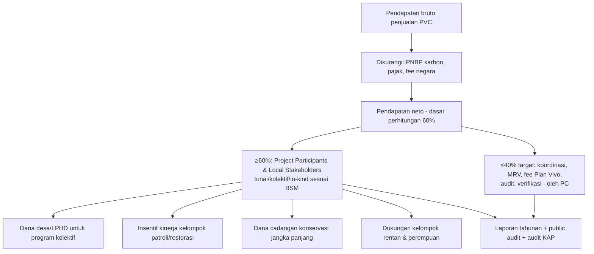

# VOLUME IV — COMMERCIAL AND FINANCIAL DEVELOPMENT

**Pasir Village Forest Community Carbon Project** · Tanggal acuan: 20 Oktober 2026
Kode: **[CR]** Confirmed Requirement · **[RP]** Recommended Practice · **[PSA]** Project-Specific Assumption · **[OCR]** Official Clarification Required · **[PRR]** Potential Regulatory Risk

**Kurs perencanaan:** **Rp17.930 per USD** — JISDOR Bank Indonesia 13 Oktober 2026 sebagaimana dilaporkan media (sumber sekunder; angka resmi untuk 14–20 Oktober tidak ditemukan). **Wajib** diperbarui dari https://www.bi.go.id/id/statistik/informasi-kurs/jisdor/ pada saat pembayaran. Semua konversi dibulatkan.

---

## Bab 19 — Project Development Costs

### 19.1 Fee resmi Plan Vivo (proyek penerbit PVC) [CR — *PV Climate – Costs & Fees*]

| Komponen biaya | Fee resmi / estimasi | Mata uang | Setara IDR | Tahap pembayaran | Penanggung | Klasifikasi | Sumber |
|---|---|---|---|---|---|---|---|
| PIN review | 1,000 | USD | 17.930.000 | Saat submission PIN | Project Coordinator | Official Confirmed Fee | CF §1.1; PM §2.2 |
| PIN review ulang (>3 putaran / >6 bulan / pipeline kedaluwarsa) | 1,000 (fee PIN review tambahan) | USD | 17.930.000 | Bila terjadi | PC | Official Confirmed Fee | PM §2.2 |
| PDD review — macroscale | 1,500 | USD | 26.895.000 | Saat submission PDD | PC | Official Confirmed Fee | CF |
| PDD review — microscale | 3,000 | USD | 53.790.000 | Saat submission PDD | PC | Official Confirmed Fee | CF |
| Validation & Verification coordination — macroscale | 1,000 | USD | 17.930.000 | Per validasi & per verifikasi | PC | Official Confirmed Fee | CF; PM §4.1, §8 |
| Validation & Verification coordination — microscale | 2,000 | USD | 35.860.000 | Per validasi & per verifikasi | PC | Official Confirmed Fee | CF |
| Additional Technical Specification review | 500 | USD | 8.965.000 | Bila menambah tech spec | PC | Official Confirmed Fee | CF |
| PDD/Tech Spec update | Variabel | USD | — | Bila update | PC | Not Yet Confirmed | CF |
| Annual Report | Gratis (proyek penerbit) | — | 0 | Tahunan | — | Official Confirmed Fee | PM §7 |
| Late Annual Report (>12 bulan terlambat) | 100 | USD | 1.793.000 | Bila terlambat | PC | Official Confirmed Fee | CF |
| Issuance | 0,40/PVC (≤50.000 PVC/proyek/tahun); 0,35/PVC di atasnya | USD | 7.172 / 6.276 per PVC | Saat issuance | PC (dari pendapatan) | Official Confirmed Fee | CF |
| Konversi fPVC/rPVC→vPVC | Gratis | — | 0 | — | — | Official Confirmed Fee | CF |
| Methodology concept note review | 350 | USD | 6.275.500 | Bila mengembangkan metodologi | Developer metodologi | Official Confirmed Fee | CF |
| Methodology assessment | Variabel + biaya panel MAP | USD | — | — | Developer | Third-Party Quotation Required | CF; PM §3.2 |
| Registrasi VVB / IE di Plan Vivo | 500 (VVB) / 100 (IE) | USD | 8.965.000 / 1.793.000 | Dibayar auditor bila belum terdaftar **[OCR siapa menanggung]** | VVB/IE (dapat dibebankan ke proyek) | Official Confirmed Fee | CF |
| Akun reseller di registry | 800 sekali + 800/tahun | USD | 14.344.000 + 14.344.000/th | Hanya bila menjadi reseller | Reseller | Official Confirmed Fee | CF |
| VAT | 20% untuk organisasi UK; organisasi internasional "typically exempt" | — | — | — | — | OCR untuk SAMPAN | CF |
| Akun Project Coordinator di PV Climate Registry (S&P Global) | Tidak tercantum di dokumen Plan Vivo | — | — | Setelah registrasi | PC | Not Yet Confirmed | PM §6.2 |

**Total fee Plan Vivo sampai registrasi [CR]:** microscale USD 6,000 (Rp107.580.000) = PIN 1,000 + PDD 3,000 + koordinasi V&V 2,000; macroscale USD 3,500 (Rp62.755.000) = PIN 1,000 + PDD 1,500 + koordinasi V&V 1,000. Per verifikasi berikutnya: USD 2,000 (Rp35.860.000) micro / USD 1,000 (Rp17.930.000) macro. Lihat juga Vol. II §9.6.

### 19.2 Biaya pihak ketiga & nasional

| Komponen | Estimasi | Klasifikasi | Catatan |
|---|---|---|---|
| Validasi oleh VVB (macroscale) | — | Third-Party Quotation Required | Minta ≥2 penawaran dari roster VVB Plan Vivo; perhatikan biaya perjalanan ke Mempawah |
| Validasi/verifikasi microscale — honor & perjalanan IE | — | Third-Party Quotation Required | Ditanggung proyek (PM §5.1) |
| Verifikasi berkala (≤5 tahun) | — | Third-Party Quotation Required | Berulang sepanjang Project Period |
| Audit keuangan tahunan (KAP) | — | Third-Party Quotation Required | Wajib PR §5.5.2 setelah ada pendapatan PVC |
| PNBP karbon per transaksi (Permenhut 6/2026 Ps. 46) | Tarif belum diverifikasi | Not Yet Confirmed | Dikurangkan sebelum perhitungan 60% (PR 3.16.2) |
| Pajak atas pendapatan penjualan (PPh/PPN) | — | Not Yet Confirmed | Perlu konsultan pajak |
| Biaya transfer bank internasional | — | Planning Estimate | — |

### 19.3 Biaya pengembangan proyek (Planning Estimate — rentang kasar, wajib diganti penawaran)

> Rentang di bawah adalah **asumsi perencanaan internal** untuk menyusun anggaran awal, **bukan** data pasar terverifikasi. Gunakan hanya untuk memperkirakan kebutuhan dana; ganti dengan penawaran resmi.

| Komponen | Rentang perencanaan (IDR) | Tahap | Klasifikasi |
|---|---|---|---|
| Analisis GIS & perubahan tutupan lahan (indikatif PIN) | 30–100 juta | Pra-PIN | Planning Estimate |
| Analisis GIS lengkap sesuai metodologi (reference region, akurasi) | 75–250 juta | PDD | Planning Estimate |
| Studi baseline sosial-ekonomi & livelihood | 50–150 juta | Pra-PIN (ringan) / PDD | Planning Estimate |
| Kajian ekologi (vegetasi & satwa) | 40–150 juta | PDD | Planning Estimate |
| Inventarisasi karbon (plot) | 100–400 juta | PDD | Planning Estimate |
| FPIC & konsultasi (3 tahap + BSM iteratif) | 75–250 juta | Pra-PIN → PDD | Planning Estimate |
| E&S Assessment + ESMP | 50–200 juta | PDD | Planning Estimate |
| Kajian & dokumentasi hukum (PKS, Project Agreement, regulasi) | 40–150 juta | Pra-PIN → PDD | Planning Estimate |
| Penyusunan PIN (staf/konsultan, terjemahan) | 30–100 juta | PIN | Planning Estimate |
| Penyusunan PDD & carbon calculations | 150–500 juta | PDD | Planning Estimate |
| Pencatatan DPP nasional & registrasi pendamping | Belum diketahui | PDD | Not Yet Confirmed |
| MRV tahunan (patroli, monitoring, AR) | Belum diketahui | Implementasi | Planning Estimate (disusun dari desain) |
| Implementasi intervensi | Belum diketahui | Implementasi | Planning Estimate (dari Technical Specification) |

### 19.4 Skenario anggaran indikatif per fase

| Fase | Komponen resmi Plan Vivo (USD) | Komponen pengembangan (rentang perencanaan, IDR) | Total indikatif (IDR) |
|---|---|---|---|
| Persiapan awal + PIN | PIN review 1,000 (≈17,9 jt) | GIS indikatif, sosial ringan, FPIC tahap i, legal awal, penyusunan PIN: ≈ 225–750 jt | ≈ 0,24–0,77 miliar |
| PDD → validasi (microscale) | PDD 3,000 + koordinasi V&V 2,000 = 5,000 (≈89,7 jt) + IE (quotation) | GIS lengkap, karbon, ekologi, ESA, FPIC lanjutan, PDD: ≈ 0,5–1,8 miliar | ≈ 0,6–1,9 miliar + IE |
| PDD → validasi (macroscale) | PDD 1,500 + koordinasi V&V 1,000 = 2,500 (≈44,8 jt) + VVB (quotation) | sama | ≈ 0,55–1,85 miliar + VVB |
| Issuance pertama | 0,40/PVC; verifikasi: koordinasi 1,000/2,000 + VVB/IE | MRV, audit, pelaporan nasional, PNBP | Tergantung volume |

**Implikasi:** total biaya hingga validasi kemungkinan berada pada orde **ratusan juta hingga ~2 miliar rupiah** (asumsi) — keputusan *go/no-go* harus memakai estimasi Carbon Benefit dari analisis teknis (Vol. III §12.5), bukan asumsi.

---

## Bab 20 — Carbon Financing Options

| Opsi | Tahap paling awal | Kelebihan | Risiko / syarat |
|---|---|---|---|
| Hibah (donor, filantropi, dana iklim, CSR) | Sekarang | Tidak membebani PVC | Persaingan; jangan mengikat hak PVC tanpa FPIC |
| Dana internal SAMPAN | Sekarang | Cepat | Kapasitas terbatas |
| Pendanaan pengembangan dari pembeli/investor (pre-financing) dengan hak pertama membeli (ROFR) | Setelah PIN approved (dianjurkan) | Membiayai PDD & validasi | Harus disetujui musyawarah; batasi volume; tidak boleh melanggar larangan pengalihan areal (PP 23/2021 Ps. 212) dan batas modal mitra 50% (Permen LHK 9/2021 Ps. 152(3)) |
| Forward purchase / offtake bersyarat | Setelah PIN; lebih kuat setelah registrasi | Kepastian pasar | Risiko gagal serah; syarat persetujuan Menhut & SRUK |
| Penjualan rPVC | Setelah registrasi + AR | Arus kas lebih awal (protection tidak bisa fPVC) | rPVC tidak bisa di-retire; pembeli harus menunggu konversi vPVC |
| Penjualan fPVC (hanya komponen restorasi) | Setelah validasi | Dana awal penanaman | 10% Achievement Reserve + 20% Future Risk Buffer; risiko "not delivered" |
| Penjualan vPVC | Setelah verifikasi | Unit dapat di-retire; label CCP/CORSIA bila memenuhi syarat | Paling lambat |
| Pembayaran berbasis hasil (RBP) / program pemerintah | Kondisional | — | Risiko double counting; Permenhut 6/2026 Ps. 30(4) melindungi hak pemegang PS |

---

## Bab 21 — Carbon Credit Commercialization

### 21.1 Akses pasar
- **Penjualan langsung** ke pembeli korporasi (dominan untuk proyek komunitas kecil).
- **Broker/reseller** — reseller dapat membuka akun di PV Climate Registry (fee USD 800 + 800/th) [CR]; Plan Vivo menampilkan daftar reseller di https://www.planvivo.org/buy-credits/resellers.
- **Bantuan buyer-matching dari Plan Vivo:** dokumen resmi tidak menjanjikan layanan perjodohan pembeli; Plan Vivo menyatakan tidak menyediakan pendanaan/dukungan teknis selain saran kepatuhan (PM §2.1) **[OCR]**.
- **Bursa karbon (IDXCarbon):** unit harus tercatat di SRUK (POJK 10/2026 — FAQ OJK) [CR — sumber resmi OJK].

### 21.2 Matriks waktu: apa yang boleh dilakukan pada tiap tahap

| Tahap | Penjualan unit terbit (mengikat) | Komitmen forward bersyarat | Pembiayaan | Catatan |
|---|---|---|---|---|
| Sebelum PIN approved | **Tidak** (tidak ada unit) | Hanya LoI tidak mengikat | Hibah/pre-financing | Jangan klaim "Plan Vivo project"; hindari menjanjikan volume |
| Setelah PIN approved (pipeline) | **Tidak** | Mungkin (term sheet/ERPA bersyarat) | Pre-financing | Boleh menyebut "Plan Vivo pipeline project"; bukan certified |
| Pengembangan PDD | **Tidak** | ERPA bersyarat (CP: validasi, persetujuan Menhut, SRUK) | Pre-financing | Volume berdasar estimasi konservatif |
| Setelah validasi/registrasi | fPVC (restorasi) setelah validasi; **tidak** untuk protection | ERPA | — | Persetujuan Menhut & SRUK **[CR nasional]** |
| Setelah AR & issuance rPVC | **Ya** (transfer rPVC; tidak bisa di-retire) | — | — | PNBP; SRUK |
| Setelah verifikasi (vPVC) | **Ya**, termasuk retirement | — | — | CA bila untuk NDC/CORSIA |

### 21.3 Perjanjian komersial — klausul kunci

| Instrumen | Klausul wajib/kunci |
|---|---|
| ERPA / Forward Sale | Conditions precedent (registrasi Plan Vivo, persetujuan Menhut penerbitan, pencatatan SRUK, Otorisasi/CA bila disyaratkan); jenis unit (rPVC/vPVC; label CA/CCP); vintage; volume minimum/maksimum; harga & eskalasi; jadwal serah; **tanpa** kewajiban penggantian yang tak terbatas bagi komunitas; alokasi risiko non-delivery & pembatalan CA (PM §15.7 menempatkan tanggung jawab rekonsiliasi pada PC — alihkan sebagian ke pembeli secara kontraktual); force majeure; hukum yang berlaku & penyelesaian sengketa; anti-korupsi; kewajiban klaim & retirement pembeli; pengungkapan ≥60% benefit sharing |
| Offtake (multi-tahun) | Sama + prioritas pembelian, mekanisme harga berkala |
| Prepayment | Penggunaan dana (budget & milestone), pengembalian bila gagal (dibatasi), jaminan yang **tidak** menggunakan areal Hutan Desa |
| Transfer | Hanya melalui PV Climate Registry (+ SRUK); kepemilikan berpindah saat transfer tercatat |
| Klaim pembeli | Hanya vPVC dapat di-retire untuk klaim offset; rPVC/fPVC tidak dapat dipakai untuk klaim |

### 21.4 Harga
- **Tidak ada data harga PVC terverifikasi** yang ditemukan dalam riset ini. Jangan memasukkan harga ke proyeksi tanpa bukti transaksi.
- Determinan harga: jenis unit (vPVC > rPVC/fPVC), label (CA, CCP, CORSIA), tipe intervensi (removal vs avoidance), co-benefit komunitas & biodiversitas, rekam jejak proyek, volume, reputasi standar, risiko regulasi negara tuan rumah (persetujuan/CA), vintage.
- Sumber yang perlu dikonsultasikan: laporan Plan Vivo *Perception vs Reality* (laman dokumen), Ecosystem Marketplace, penawaran dari reseller Plan Vivo, dan data transaksi proyek Plan Vivo Indonesia (mis. Bujang Raba) bila dapat diperoleh.
- Model pendapatan harus menyajikan **tiga skenario harga** yang bersumber dari penawaran nyata, dan selalu memotong: buffer (20%), achievement reserve (10% bila rPVC/fPVC), uncertainty deduction metodologi, leakage, PNBP, fee issuance, pajak.

---

## Bab 22 — Carbon Revenue and Benefit Sharing

### 22.1 Persyaratan yang terverifikasi

| Sumber | Ketentuan | Klasifikasi |
|---|---|---|
| PR 3.16.2 | ≥60% pendapatan penjualan PVC, **setelah** pungutan/pajak/fee negara tuan rumah, langsung bermanfaat bagi Project Participants & Local Stakeholders; boleh <60% untuk issuance tertentu asalkan total periode kredit ≥60% | CR |
| PR 3.16 Guidance | Bila biaya koordinasi, manajemen & MRV >40% pendapatan, PC harus mencari sumber dana lain | CR |
| PR 3.16.1, 3.16.3–3.16.6 | BSM iteratif; draf & final dibagikan; proporsi untuk partisipan, PC, pihak lain; bentuk (tunai, pelatihan, in-kind); dependensi & target; ringkasan di Project Agreement | CR |
| PR 5.5 | Prosedur keuangan transparan; audit tahunan independen; rekening terpisah dianjurkan | CR/RP |
| Permenhut 6/2026 Ps. 12(2)(d), 54, 55 | Rencana pembagian manfaat karbon disepakati masyarakat dalam DPP; dilaporkan & dievaluasi | CR |
| Permen LHK 9/2021 Ps. 152(3) | Modal mitra dalam kerja sama bagi hasil maks. 50% modal pemegang PS | CR — relevansi pada struktur investasi **[PRR]** |
| Persentase pembagian nasional untuk karbon PS | **Tidak ditemukan** regulasi yang menetapkan persentase | — |

### 22.2 Revenue Distribution Governance Framework (usulan)

Prinsip: (1) rekening khusus proyek; (2) persetujuan alokasi tahunan oleh musyawarah; (3) public audit tahunan (Toolkit Tool 16); (4) pelaporan di Annual Report & sistem nasional; (5) biaya pengembangan yang telah dibiayai pihak ketiga hanya dapat dikembalikan dari porsi ≤40% atau sesuai kontrak yang disetujui musyawarah dan tetap menjaga ≥60% sepanjang periode kredit.

Alokasi indikatif di atas **bukan** persentase wajib; ditetapkan melalui proses BSM partisipatif.

---

## Bab 23 — Financial and Commercial Risks

### 23.1 Commercial Risk Matrix

| Risiko | Penyebab | Likelihood | Dampak | Mitigasi |
|---|---|---|---|---|
| Volume kredit kecil | Areal kecil; PT002 tidak applicable; deduction | Tinggi [PSA] | Tinggi | Uji kelayakan teknis sebelum investasi besar; pertimbangkan proyek gabungan (Permenhut Ps. 7) |
| Regulasi berubah/tertunda | Peraturan pelaksana baru (Perpres 110 Ps. 102) | Sedang | Tinggi | Klausul CP; pemantauan regulasi |
| Areal tidak eligible perdagangan | Permenhut Ps. 9(1)(a) | Belum diketahui | Kritis | Klarifikasi sebelum PIN |
| Persetujuan Menhut kedaluwarsa (6 bulan) | Keterlambatan issuance/penjualan | Sedang | Sedang | Sinkronkan jadwal |
| Otorisasi/CA ditolak/dibatasi | Kebutuhan NDC (Ps. 26) | Sedang | Tinggi untuk pembeli CA | Jual sebagai non-authorised; jangan janjikan CA |
| Pembatalan CA setelah penjualan | Pelaporan negara | Rendah–Sedang | Tinggi | Alihkan risiko kontraktual; asuransi; tunggu konfirmasi (PM §15.7.1) |
| Gagal serah forward | Underperformance, reversal | Sedang | Tinggi | Volume forward ≤ porsi konservatif; tanpa denda berat bagi komunitas |
| Reversal (kebakaran, banjir/kekeringan, konversi) | Faktor alam/manusia | Sedang | Tinggi | Mitigasi di project logic; buffer 20% |
| Harga rendah | Pasar sukarela | Sedang | Tinggi | Pembeli berbasis co-benefit; diversifikasi pendanaan |
| Biaya > pendapatan | Skala kecil | Tinggi [PSA] | Tinggi | Microscale route; proyek gabungan; hibah |
| Reputasi (klaim berlebihan) | Komunikasi | Rendah | Tinggi | Pakai status resmi (pipeline ≠ certified) |
| Kurs | IDR/USD | Sedang | Sedang | Kontrak USD; lindung nilai sederhana |
