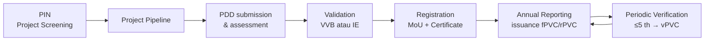
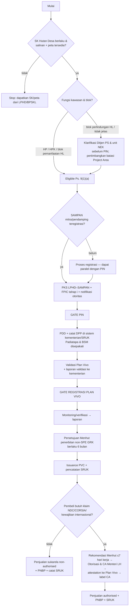

# VOLUME I — STRATEGIC AND REGULATORY GUIDELINE

**Pasir Village Forest Community Carbon Project** — Hutan Desa Pasir, Kab. Mempawah, Kalimantan Barat
Tanggal acuan riset: **20 Oktober 2026** · LPHD Pasir (SK.10885/MENLHK-PSKL/PKPS/PSL.0/2019) · Fasilitator: SAMPAN Kalimantan · Standar: Plan Vivo — PV Climate

Kode klasifikasi: **[CR]** Confirmed Requirement · **[RP]** Recommended Practice · **[PSA]** Project-Specific Assumption · **[OCR]** Official Clarification Required · **[PRR]** Potential Regulatory Risk

---

## Bab 1 — Executive Summary

### 1.1 Jawaban atas empat keputusan praktis

| Keputusan | Jawaban singkat |
|---|---|
| **1. Apakah kita siap menyusun dan mengajukan PIN?** | **Siap mulai menyusun; belum siap mengajukan.** Per 20/10/2026 belum ada bukti terverifikasi untuk: Project Coordinator & mandat tertulis LPHD, peta Project Area, klasifikasi ekosistem, fungsi kawasan (HL/HP) dan blok/zona areal, kecocokan metodologi, keputusan FPIC tahap (i), skrining E&S, dan notifikasi otoritas. **Target PIN:** submission **31 Maret 2027** (rentang Feb–Apr 2027), PIN approved/masuk pipeline **Juli–September 2027** (Vol. II §9.9). Fee PIN review **USD 1,000 = Rp17.930.000**. |
| **2. Apa yang harus diselesaikan sebelum submit?** | 13 kriteria kesiapan (Vol. II §9.8). Lima yang paling kritis: (a) mandat LPHD–SAMPAN & penetapan Project Coordinator; (b) **fungsi kawasan dan blok/zona areal Hutan Desa** (penentu kelayakan perdagangan karbon menurut Permenhut 6/2026 Pasal 9); (c) analisis tutupan lahan ≥10 th untuk menguji jalur metodologi PT002; (d) FPIC tahap (i); (e) Annex 3–5 PIN. |
| **3. Proses resmi masuk project pipeline?** | **PIN approved = masuk project pipeline** (Procedures Manual V3.9 §2.2). Tidak ada aplikasi pipeline terpisah. Jalur: email PIN (template V1.4) ke projects@planvivofoundation.org + fee USD 1,000 → PIN review report (≈6 minggu) → revisi ≤6 bulan, maks. 3 putaran → approval → PIN dipublikasikan di planvivo.org/pipeline. Pipeline berlaku 3 tahun untuk mengajukan PDD. Pipeline **bukan** registrasi/sertifikasi dan tidak menghasilkan PVC. |
| **4. Langkah dari PIN sampai penjualan?** | PDD (template V5.7, metodologi **approved**) → screening → konsultasi publik 4 minggu → review → validasi (VVB; atau IE bila <10.000 tCO2e/th) → MoU & registrasi → akun PV Climate Registry (S&P Global) → Annual Report → rPVC/vPVC → verifikasi ≤5 th. **Paralel di Indonesia (Permenhut 6/2026):** pencatatan DPP oleh mitra/pendamping **teregistrasi** → validasi/verifikasi → **persetujuan Menteri Kehutanan** untuk penerbitan non-SPE GRK oleh standar internasional (berlaku 6 bulan) → pencatatan di **SRUK** → PNBP per transaksi → bila dijual untuk NDC negara lain/CORSIA/kewajiban internasional: rekomendasi Menhut + **Otorisasi & Corresponding Adjustment** Menteri LH. |

### 1.2 Temuan paling penting

1. **[CR]** Fee resmi Plan Vivo (PDF *PV Climate – Costs & Fees*; kurs Rp17.930/USD): PIN review USD 1,000 (Rp17.930.000); PDD review USD 1,500 (Rp26.895.000) macroscale / USD 3,000 (Rp53.790.000) microscale; koordinasi Validasi & Verifikasi USD 1,000 (Rp17.930.000) macro / USD 2,000 (Rp35.860.000) micro; issuance USD 0.40/PVC (Rp7.172) untuk ≤50.000 PVC/th. **Total fee Plan Vivo sampai registrasi: USD 6,000 (Rp107.580.000) microscale atau USD 3,500 (Rp62.755.000) macroscale**, belum termasuk biaya VVB/IE. Rincian: Vol. II §9.6.
2. **[CR]** Protection (REDD) **hanya** dapat menghasilkan rPVC/vPVC; fPVC (ex-ante) hanya untuk intervensi removal (restorasi). Implikasi: arus kas karbon untuk komponen perlindungan baru muncul setelah registrasi dan monitoring.
3. **[CR+PSA]** Jalur metodologi approved yang paling relevan: **PM001 + PU002 + PT002** (REDD di hutan yang dikelola masyarakat). PT002 **tidak dapat dipakai** bila baseline mencakup *effective community management* — isu serius bagi Hutan Desa yang sudah berizin sejak 2019.
4. **[CR]** Desa Pasir **tidak memiliki mangrove** (dikonfirmasi tim proyek 21/10/2026), sehingga proyek tidak bergantung pada metodologi mangrove yang masih pipeline. Pertanyaan ekosistem yang tersisa: **gambut atau tanah mineral**. Restorasi/rewetting gambut tidak punya jalur karena PM001 melarang aktivitas yang memengaruhi muka air tanah; perlindungan hutan rawa gambut dapat dikreditkan untuk biomassa, sedangkan perlakuan emisi tanah gambut perlu klarifikasi.
5. **[CR — teks resmi]** **Perpres 110/2025** (10/10/2025) mencabut Perpres 98/2021; **Permenhut 6/2026** (diundangkan 13/04/2026) mencabut Permen LHK 7/2023 dan mengatur jalur unit non-SPE GRK dari standar internasional.
6. **[PRR]** Permenhut 6/2026 Pasal 9 ayat (1) huruf a: karbon yang dapat diperdagangkan dari kawasan hutan negara dibatasi pada **hutan produksi** dan **blok pemanfaatan hutan lindung** yang telah dibebani persetujuan. Jika sebagian/seluruh Hutan Desa Pasir berada di blok perlindungan hutan lindung (perlu dicek pada SK & RKPS), kelayakan perdagangan untuk areal itu **harus diklarifikasi** ke Kementerian Kehutanan, meskipun Permen LHK 9/2021 Pasal 121 membolehkan kegiatan penyerapan/penyimpanan karbon di blok perlindungan.
7. **[CR — teks resmi]** Permenhut 6/2026 Pasal 6(2): pemegang Persetujuan Perhutanan Sosial **wajib didampingi mitra atau pendamping yang teregistrasi**; Pasal 13(1)(b): DRAM/DPP **disusun oleh mitra/pendamping teregistrasi**. Ini mengukuhkan peran SAMPAN — **dengan syarat SAMPAN teregistrasi**.
8. **[CR — sumber resmi Plan Vivo & KLH]** Plan Vivo dan Kementerian LH menandatangani **Mutual Recognition Agreement** (diumumkan 17/09/2025) yang mengakui PV Climate. Proyek Plan Vivo **Bujang Raba** (Hutan Desa, Jambi, KKI Warsi) termasuk empat proyek pertama yang memperoleh persetujuan Menteri Kehutanan (6/07/2026) dan masuk SRUK (diluncurkan 9/07/2026). Ini preseden kuat bahwa jalur Hutan Desa–Plan Vivo dapat berfungsi.
9. **[CR]** Dua PIN Hutan Desa Indonesia telah *approved* Plan Vivo: Lemo Nakai (KKI Warsi; PIN V3.0, 24/07/2024) dan Mane, Pidie (CFES & F&F; PIN V5.1, 28/05/2025) — menunjukkan beberapa putaran revisi wajar terjadi.

### 1.3 Rekomendasi inti (90 hari)
1. Tandatangani PKS LPHD–SAMPAN dan tetapkan Project Coordinator (rekomendasi kerja: SAMPAN, atas mandat LPHD) — **sekaligus** proses registrasi SAMPAN sebagai mitra/pendamping teregistrasi.
2. Peroleh salinan SK Hutan Desa + peta + **fungsi kawasan & blok/zona** (RKHD/RKPS).
3. Lakukan analisis tutupan lahan & reference region (uji PT002) dan klasifikasi gambut/tanah mineral.
4. Kirim email permintaan *introductory call* ke Plan Vivo (draf di Vol. V Bab 29).
5. Laksanakan FPIC tahap (i) dengan dokumentasi lengkap.
6. Susun PIN paralel; ajukan hanya bila 13 kriteria terpenuhi.

---

## Bab 2 — Plan Vivo PV Climate Framework

### 2.1 Arsitektur standar
- **PV Climate** = standar karbon Plan Vivo untuk proyek berbasis masyarakat/petani kecil (Project Requirements V5.x). Proyek menghasilkan **Plan Vivo Certificates (PVCs)**.
- Dokumen inti: Project Requirements (PR), Methodology Requirements, Validation & Verification Requirements, Glossary + Procedures Manual (PM), V&V Procedures Manual, template PIN/PDD/Annual Report, dan metodologi/modul/tool.
- **Prinsip kunci [CR]:** intervensi Protection/Restoration/Improved Management; partisipan petani/komunitas skala kecil (PR §2.3); ≥60% pendapatan PVC langsung untuk partisipan & local stakeholders (PR §3.16.2); FPIC 3 tahap (PR §2.6); Risk Buffer 20% (PR §3.11); Crediting Period 10–50 tahun (PR §3.15); risiko reversal dikelola ≥50 tahun (PR §3.11.1); verifikasi ≤ tiap 5 tahun (PR §4.7.1).
- **Ruang lingkup:** proyek tunggal atau berkelompok; proyek yurisdiksi/JREDD tidak disertifikasi; tidak ada batas geografis; *start date* hingga 5 tahun sebelum validasi selesai (PM §7).

### 2.2 Siklus sertifikasi resmi [CR — PM §1]

### 2.3 Macroscale vs Microscale [CR]
- **Microscale** (<10.000 tCO2e/th): boleh validasi/verifikasi melalui Plan Vivo + **Independent Expert (IE)** — lebih murah, tetapi vPVC **tidak** eligible label CCP/CORSIA (PM §8.2).
- **Macroscale** (≥10.000 tCO2e/th): wajib **VVB** yang disetujui Plan Vivo.
- Ambang dalam dokumen sedikit berbeda (lihat Vol. III §16.1) — **[OCR]** bila estimasi mendekati 10.000.

---

## Bab 3 — Official Requirements and Guideline Library

### 3.1 Master Document Register

| No | Dokumen resmi | Versi | Tanggal efektif / rilis | Fungsi | Tahap | Mandatory/Guidance | URL resmi |
|---|---|---|---|---|---|---|---|
| 1 | PV Climate Project Requirements | V5.7 | 30/04/2026 (rilis; ketentuan baru berlaku ≤12 bulan kecuali ditentukan lain — PM §11.1.2) | Persyaratan proyek | PIN–verifikasi | Mandatory | https://s3.eu-west-2.amazonaws.com/assets.planvivo.org/documents/PV-Climate-Documents/PV-Climate_Project-Requirements_V5.7.pdf |
| 2 | PV Climate Procedures Manual | V3.9 | 30/04/2026 | Prosedur PIN, PDD, validasi, registrasi, issuance, buffer, CA | Semua | Mandatory | …/PV-Climate_Procedures-Manual_V3.9.pdf |
| 3 | Methodology Requirements | V1.2 | 03/09/2024 | Syarat metodologi | Metodologi | Mandatory (bagi developer metodologi) | …/PV-Climate_Methodology-Requirements_V1.2.pdf |
| 4 | Validation & Verification Requirements | V1.1 | 01/11/2023 | Syarat V&V, VVB, IE | Validasi/verifikasi | Mandatory | …/PV-Climate_Validation-Verification-Requirements_V1.1.pdf |
| 5 | Validation & Verification Procedures Manual | V1.4 | 19/12/2025 (versi terakhir di tabel kontrol) | Prosedur audit, approval VVB/IE | Validasi/verifikasi | Mandatory | …/PV-Climate_Validation-and-Verification-Procedures-Manual_V1.4.pdf |
| 6 | Glossary | V1.5 | 23/03/2026 | Definisi | Semua | Mandatory (interpretasi) | …/PV-Climate_Glossary_V1.5.pdf |
| 7 | PIN Template | V1.4 | Tidak tercantum; versi di laman per 20/10/2026 | Format PIN | PIN | Mandatory | …/PV-Climate_V5_PIN-Template_V1.4.docx |
| 8 | PDD Template | V5.7 | Tidak tercantum; versi di laman per 20/10/2026 | Format PDD | PDD | Mandatory | …/PV-Climate_PDD-Template_V5.7.docx |
| 9 | Annual Report Template | V5_1.3 | Tidak tercantum | Pelaporan tahunan | Pasca-registrasi | Mandatory | …/PV-Climate_Annual-Report-Template_V5_1.3.docx |
| 10 | Methodology Concept Note / Methodology / Module templates | V1.1 | Tidak tercantum | Pengembangan metodologi baru | Bila perlu | Mandatory bila mengembangkan metodologi | laman dokumen |
| 11 | Public Consultation Guidance Manual | V1.0 | Tidak tercantum | Tata cara konsultasi publik PDD/metodologi | PDD | Guidance | …/PV-Climate_Public-Consultation-Guidance_V1.pdf |
| 12 | E&S Safeguards Risk Management in Plan Vivo Projects | V1.0 | Agustus 2024 | Exclusion list, screening, ESA, ESMP | PIN–implementasi | Guidance (kuesioner wajib via template) | …/ESRiskManagement_PlanVivoProjects_V1.0.pdf |
| 13 | E&S Assessment Guidance | V1.0 | Tidak tercantum | Panduan ESA | PDD | Guidance | …/ESAssessmentGuidance_PlanVivoProjects_V1.0.pdf |
| 14 | Participatory Toolkit | — | Laman web | Tools 1–17 | Semua | Recommended | https://www.planvivo.org/participatory-toolkit |
| 15 | Approved methodologies/modules/tools (PM001, PM002, PU001–PU009, PT001–PT006) | lihat Vol. III §12.1 | lihat Vol. III | Kuantifikasi karbon | PDD | Mandatory (yang dipilih) | https://www.planvivo.org/projects/certify-a-project/pvclimate/methodologies |
| 16 | PV Climate – Costs & Fees | tanpa versi | Diakses 20/10/2026 | Fee resmi | Semua | Mandatory | https://s3.eu-west-2.amazonaws.com/assets.planvivo.org/documents/PV-Climate-Documents/PV-Climate-Costs-Fees.pdf |
| 17 | PV Climate Registry (S&P Global) | — | — | Issuance, transfer, retirement | Pasca-registrasi | Mandatory | https://mer.markit.com/br-reg/public/customer-registration.jsp |
| 18 | Terjemahan Bahasa Indonesia: Glosarium V1.5, Persyaratan Metodologi V1.2, Manual Prosedur V3.9, Persyaratan Proyek V5.7, Persyaratan V&V V1.1, Manual Prosedur V&V V1.4 | sama | — | Bahan sosialisasi | Semua | Referensi (versi Inggris yang mengikat **[OCR]**) | laman dokumen, folder "Dokumen-dalam-Bahasa-Indonesia" |
| 19 | Plan Vivo Standard V4 (2013) & dokumen V4 | V4 | 2013 | Arsip | — | **Tidak berlaku** untuk proyek baru | laman dokumen |

(…/ = `https://s3.eu-west-2.amazonaws.com/assets.planvivo.org/documents/PV-Climate-Documents/`)

**Catatan versi [CR]:** PM §11.1.2 — pembaruan berlaku dalam 12 bulan kecuali dinyatakan lain, dan proyek divalidasi/diverifikasi terhadap versi terbaru yang sudah berlaku. Selalu cek ulang laman dokumen pada hari submission.

### 3.2 Ringkasan per dokumen inti

**(1) Project Requirements V5.7** — Bagian 1 Eligible Interventions (1.1 intervensi; 1.2 hak kelola, batas, larangan pemindahan paksa); 2 Stakeholder Engagement (2.1–2.6 termasuk FPIC); 3 Project Design (baseline 3.1–3.4; project logic 3.5; technical specification 3.6–3.8; risk management 3.9–3.13; agreements 3.14–3.18); 4 Monitoring & Reporting (4.1–4.10); 5 Governance & Administration (5.1–5.5).
*Implikasi Pasir:* seluruh persyaratan dinilai bertahap: PIN menguji kelayakan dasar; PDD harus memenuhi semuanya. Persyaratan yang paling sensitif: 1.2.1 (hak manfaat dari penjualan PVC), 2.2 (Project Coordinator), 2.6 (FPIC), 3.7.3 (Regulatory Surplus), 3.13 (double counting), 3.16 (≥60%), 5.3.2 (bukti otoritas diinformasikan & tidak keberatan), 5.5.2 (audit keuangan tahunan).
*Aksi:* gunakan matriks kelayakan Bab 4.

**(2) Procedures Manual V3.9** — §1 proses; §2 PIN; §3 metodologi; §4 macroscale; §5 microscale; §6 registrasi & registry; §7 Annual Report; §8 verifikasi; §9 timeline; §10 update PDD; §11 update standar; §12–13 suspensi & dekertifikasi; §14–16 PVC, buffer, CA, loss events; §17 non-issuing.
*Aksi:* SOP Vol. II Bab 9 dan roadmap Vol. III Bab 16 diturunkan dari dokumen ini.

**(3) PIN Template V1.4** — lihat Vol. II Bab 7.

**(4) PDD Template V5.7** — lihat Vol. III Bab 15 (17 annex).

**(5) Methodology Requirements V1.2** — relevan hanya bila tidak ada metodologi approved yang cocok (mis. restorasi hidrologi gambut); concept note USD 350 dahulu.

**(6) V&V Requirements V1.1 & Procedures Manual V1.4** — VVB/IE harus disetujui Plan Vivo; audit plan disetujui sebelum site visit; maks 3 FAR.

**(7) E&S Risk Management V1.0** — tahap 1 PIN: Exclusion List + E&S Screening; tahap 2 PDD: E&S Assessment (tailored ESA; ESIA bila high risk) + ESMP (moderate); tahap 3 implementasi: monitoring tahunan, verifikasi, evaluasi akhir ESMP.

**(8) Public Consultation Guidance V1.0** — PDD dipublikasikan di laman pipeline; feedback lewat email ke projects@; dipertimbangkan VVB saat validasi dan dimuat dalam validation report.

**(9) Costs & Fees** — lihat Vol. IV Bab 19.

---

## Bab 4 — Pasir Project Eligibility Assessment (Pre-PIN Eligibility Assessment Matrix)

Status: **Confirmed Compliant / Partially Ready / Information Required / Potential Non-Compliance / Not Applicable**

| Requirement | Referensi resmi | Bukti proyek Pasir (per 20/10/2026) | Status | Gap | Aksi | Prioritas |
|---|---|---|---|---|---|---|
| Intervensi masuk kategori Protection/Restoration/Improved Mgmt | PR 1.1.1 | Belum ditetapkan | Information Required | Desain intervensi | Analisis driver + desain partisipatif | Tinggi |
| Manfaat livelihood bukan hanya dari PVC/upah | PR 1.1.2 | — | Information Required | Usaha livelihood | Identifikasi HHBK/jasa lingkungan | Sedang |
| Partisipan punya hak statutory/customary untuk mengelola & **memperoleh manfaat dari penjualan PVC** | PR 1.2.1 | SK Hutan Desa 2019 (nomor) | Partially Ready | Salinan SK; hak atas manfaat karbon tunduk Permenhut 6/2026 | Kajian hukum; konfirmasi Plan Vivo | **Kritis** |
| Areal di dalam Project Region, batas dipetakan | PR 1.2.2 | — | Information Required | SHP | GIS | Tinggi |
| Tidak ada pemindahan paksa fisik/ekonomi | PR 1.2.3 | — | Information Required | Analisis pembatasan akses | Skrining E&S | Tinggi |
| Kawasan **eligible untuk perdagangan karbon nasional** | Permenhut 6/2026 Ps. 9(1)(a) | Fungsi & blok belum diketahui | Information Required / **Potential Non-Compliance** bila blok perlindungan HL | Fungsi kawasan & blok | Cek SK, RKHD, peta kawasan; klarifikasi Ditjen PS | **Kritis** |
| Stakeholder analysis | PR 2.1 | Identifikasi awal (belum terdokumentasi) | Partially Ready | Dokumen | Tool 1 | Tinggi |
| Project Coordinator berbadan hukum & berkapasitas | PR 2.2.1 | SAMPAN (legalitas belum dihimpun) | Information Required | Akta, pengalaman | Kumpulkan; putuskan PC | **Kritis** |
| Pembagian fungsi diformalkan tertulis | PR 2.2.2 | PKS dalam persiapan | Partially Ready | PKS | Finalisasi | **Kritis** |
| Mitra/pendamping **teregistrasi** (hukum nasional) | Permenhut 6/2026 Ps. 6(2), 13(1)(b) | Belum diketahui | Information Required | Registrasi SAMPAN | Cek prosedur registrasi pendamping/mitra PS | **Kritis** |
| Partisipan residen, skala kecil, tidak bergantung tenaga upahan | PR 2.3 | — | Information Required (kemungkinan besar terpenuhi **[PSA]**) | Data rumah tangga | Survei | Sedang |
| Desain partisipatif & inklusif | PR 2.4 | Koordinasi awal | Partially Ready | Rangkaian FGD | Rencana | Tinggi |
| Stakeholder Engagement Plan | PR 2.5.1 | — | Information Required | SEP | Draf | Sedang |
| FPIC 3 tahap; tahap (i) | PR 2.6; PIN Annex 4 §C | Persiapan | Information Required | BA tahap (i) | Musyawarah | **Kritis** |
| Baseline sesuai metodologi approved | PR 3.1–3.2 | — | Information Required | Analisis tutupan | GIS | Tinggi |
| Metodologi approved applicable | PR 3.2 Guidance; PM §3 | PT002 kandidat | Information Required | Uji "effective community management"; perlakuan tanah gambut | Analisis + tanya Plan Vivo | **Kritis** |
| Additionality & Regulatory Surplus | PR 3.7 | — | Information Required / **[PRR]** | Kewajiban hukum pemegang PS | Kajian hukum | Tinggi |
| Tidak ada konversi ekosistem alami 10 th (restorasi) | PR 3.8, 3.9.13 Guidance | — | Information Required | Citra historis | GIS | Tinggi |
| Exclusion List | PR 3.9.2 | — | Information Required | Annex 3 | Isi | Sedang |
| Spesies asli | PR 3.9.10 | — | Not yet applicable | — | Desain restorasi | Rendah |
| MoU instansi penegak hukum bila patroli didukung pemerintah | PR 3.9.9 | — | Information Required | — | Putuskan model patroli | Sedang |
| Tidak tumpang tindih/terdaftar di program lain | PR 3.13.1, 3.13.5 | — | Information Required | Cek registri | SRN/SRUK, Verra, GS | Tinggi |
| Bukti otoritas diinformasikan, tanpa keberatan | PR 5.3.2; PIN Annex 5 | — | Information Required | Surat | Kirim | Tinggi |
| Audit keuangan tahunan | PR 5.5.2 | — | Not Applicable s.d. ada pendapatan (siapkan) | Anggaran audit | Rencana | Rendah |
| Rencana keuangan | PR 5.4; PIN 4.3 | — | Information Required | Anggaran | Susun | Sedang |

**Isu kelayakan kritis yang perlu klarifikasi dini dengan Plan Vivo:** (1) penerimaan struktur PC (SAMPAN) + LPHD sebagai wakil partisipan; (2) penerapan PT002 pada Hutan Desa berizin sejak 2019 dan perlakuan emisi tanah gambut; (3) cara Plan Vivo memperlakukan persyaratan nasional (persetujuan Menhut, SRUK, PNBP, kemungkinan pembatalan/pemindahan unit ke registri nasional) dalam PIN/PDD; (4) implikasi MRA KLH–Plan Vivo terhadap proyek baru.

---

## Bab 5 — Indonesian Legal and Institutional Requirements

> Basis verifikasi: teks resmi Perpres 110/2025, Permenhut 6/2026, Permen LHK 9/2021, PP 23/2021 telah dibaca (pasal yang dikutip). Ketentuan yang hanya bersumber dari siaran pers resmi atau sumber sekunder ditandai. **Kajian ini bukan opini hukum** — wajib dikonfirmasi oleh penasihat hukum dan instansi terkait.

### 5.1 Peta regulasi utama per 20/10/2026

| Regulasi | Status | Inti relevansi |
|---|---|---|
| **PP 23/2021** tentang Penyelenggaraan Kehutanan | Berlaku | Hutan Desa di HL & HP (Ps. 204); usaha jasa lingkungan & kerja sama dengan para pihak (Ps. 206); persetujuan kepada lembaga desa (Ps. 215(1)); jasa lingkungan di HL & HP (Ps. 215(2)); 35 th dapat diperpanjang (Ps. 216); **persetujuan bukan kepemilikan kawasan** (Ps. 218); larangan memindahtangankan/menyewakan areal (Ps. 212) |
| **Permen LHK 9/2021** tentang Pengelolaan Perhutanan Sosial | Berlaku (tidak ditemukan pengganti 2025–26) | Definisi pendamping & kemitraan (Ps. 1); hak & kewajiban pemegang (Ps. 90, 93 — termasuk PNBP); **penyerapan/penyimpanan karbon** diperbolehkan: HL blok perlindungan (Ps. 121 huruf c), HL blok pemanfaatan (Ps. 124(1) huruf g), HP (Ps. 129 huruf f; 132(1) huruf g); gambut fungsi lindung: perdagangan karbon (Ps. 175(1) huruf d); kerja sama usaha & batas modal mitra bagi hasil 50% (Ps. 151–152); pendampingan (Ps. 154) |
| **Perpres 110/2025** tentang Penyelenggaraan Instrumen NEK dan Pengendalian Emisi GRK Nasional | Berlaku sejak 10/10/2025; **mencabut Perpres 98/2021** (Ps. 101) | SRUK (Ps. 1 angka 20); Otorisasi (Ps. 1 angka 27); CA (Ps. 1 angka 28); DPP (Ps. 1 angka 41); semua offset dihitung ke NDC kecuali ada CA (Ps. 56); semua perdagangan dicatat di SRUK (Ps. 58–59); penerbitan unit non-SPE oleh standar internasional dengan persetujuan menteri sektor (Ps. 65(6)); unit standar internasional dapat diperdagangkan domestik (Ps. 67); perdagangan luar negeri: Otorisasi + CA wajib untuk Art. 6, linked ETS, dan offset sukarela untuk kewajiban internasional — **tidak** wajib untuk offset sukarela yang tidak dipakai untuk NDC/kewajiban internasional (Ps. 68(1)); validator/verifikator terakreditasi KAN atau badan akreditasi internasional (Ps. 85); pencatatan aksi mitigasi di SRN PPI (Ps. 87); peraturan pelaksana dalam 1 tahun (Ps. 102) |
| **Permen LHK 21/2022** Tata Laksana NEK | Berlaku sepanjang tidak bertentangan dengan Perpres 110 (Ps. 100 huruf c Perpres 110) — **[PRR]** status parsial | Rujukan MRA Plan Vivo |
| **Permenhut 6/2026** Tata Cara Perdagangan Karbon melalui Offset Emisi GRK Sektor Kehutanan | Diundangkan 13/04/2026; berlaku; **mencabut Permen LHK 7/2023** | Lihat §5.2 |
| **Permen LH/Kepala BPLH 10/2026** (SRUK) | Berlaku (sumber: siaran pers KLH & Plan Vivo, 9/07/2026) — **teks belum diverifikasi** **[OCR]** | Registri unit karbon nasional |
| **POJK 14/2023** jo. **POJK 10/2026** (Bursa Karbon) | Berlaku (FAQ resmi OJK) | Unit di bursa harus tercatat di SRUK; unit luar negeri non-SRUK dapat diperdagangkan |
| **MRA Kementerian LH – Plan Vivo** | Ditandatangani (diumumkan 17/09/2025) — **teks lengkap tidak publik** | Pengakuan kredit PV Climate dalam kerangka Permen LHK 21/2022 & SPE |
| Kepmen Rencana Operasional FOLU Net Sink 2030 | Berlaku (nomor lengkap belum diverifikasi) | Target −140 Mt CO2e 2030; PS sebagai pengungkit; Menhut dapat membatasi volume otorisasi (Permenhut 6/2026 Ps. 26) |

### 5.2 Permenhut 6/2026 — ketentuan yang langsung mengikat Pasir [CR — teks resmi]

| Pasal | Ketentuan | Implikasi Pasir |
|---|---|---|
| 1 angka 11; 6(1) huruf b | Pemegang Persetujuan Pengelolaan PS (termasuk Hutan Desa) adalah Pelaku Usaha yang dapat berdagang karbon | LPHD Pasir **dapat** menjadi Pelaku Usaha |
| **6(2)** | Pemegang PS **harus didampingi mitra atau pendamping yang teregistrasi** | SAMPAN harus teregistrasi; tata cara registrasi "sesuai peraturan perundang-undangan" **[OCR]** |
| 7 | Aksi mitigasi gabungan (IAD atau di luar IAD) | Opsi menggabung dengan Hutan Desa lain di Mempawah/Kalbar |
| **9(1) huruf a** | Karbon dari kawasan hutan: HP tetap, HPK, dan/atau **blok pemanfaatan HL** yang telah dibebani persetujuan | **Kritis:** areal di **blok perlindungan HL** tidak tercantum → **[PRR]** |
| 10 | Unit: SPE GRK (diterbitkan Menteri LH) atau **non-SPE GRK oleh standar internasional** (dengan persetujuan Menhut) | PVC = non-SPE GRK |
| 12(1)–(2) | Isi DRAM/DPP: rencana & usulan aksi mitigasi, metodologi, analisis dampak lingkungan & pembangunan berkelanjutan, konsultasi publik, data pendukung: penanggung jawab, additionality, rencana pelibatan masyarakat, **rencana pembagian manfaat karbon yang disepakati masyarakat**, biodiversitas & risiko aksi balik, **rencana dan capaian Padiatapa** | PDD Plan Vivo dapat menjadi basis DPP, tetapi perlu penyesuaian format sistem kementerian |
| **13(1) huruf b** | DRAM/DPP pemegang PS **disusun oleh mitra/pendamping teregistrasi** | Peran SAMPAN |
| 14, 16 | Kelengkapan ≤5 hari kerja; penilaian ≤14 hari kerja (Ditjen PS untuk pemegang PS) | Jadwal administrasi nasional singkat — tetapi bergantung kesiapan sistem |
| 20–22 | Pencatatan DPP; pelaporan validasi, pelaksanaan, verifikasi | Paralel dengan PDD Plan Vivo |
| **24** | Persetujuan Menhut untuk penerbitan non-SPE GRK berlaku **6 bulan**; disampaikan ke lembaga standar | Sinkronkan dengan permintaan issuance ke Plan Vivo |
| 25–27 | Perdagangan luar negeri yang memerlukan Otorisasi & CA: permohonan ke Menhut dengan perjanjian kerja sama perdagangan → rekomendasi volume ≤7 hari kerja → permohonan ke Menteri LH | Untuk pembeli yang butuh CA |
| 28–29 | Safeguard LST wajib & sistem manajemen risiko | Selaras dengan PV Climate |
| 30(4), 31 | Program yurisdiksi tidak boleh memperdagangkan karbon dari areal berizin tanpa persetujuan pemegang; **nesting wajib** | Lindungi hak LPHD; antisipasi nesting |
| 42–43 | Verifikator terakreditasi KAN/internasional; untuk pemegang PS dapat **ahli perorangan** terdaftar pada lembaga akreditasi internasional | Apakah IE Plan Vivo memenuhi Ps. 43(2)? **[OCR]** |
| **46** | **PNBP** pemanfaatan hutan atas penyerapan/penyimpanan karbon untuk setiap transaksi offset, dibayar via SIPNBP | Tarif belum diverifikasi **[OCR]**; masukkan ke model keuangan & BSM ("after payment of any charges, taxes or similar fees levied by the host country" — PR 3.16.2) |
| 48–50, 54–55 | Pengaduan publik; pelaporan elektronik (termasuk pelaksanaan pembagian manfaat & pengaduan); evaluasi ≥1×/th | Beban pelaporan ganda (Plan Vivo + nasional) |
| 60 | Sebelum SRUK beroperasi penuh, DRAM/DPP dicatat di sistem elektronik kementerian | — |
| 61 | Transisi bagi proyek yang sudah validasi/punya unit: lapor ≤6 bulan (≈13/10/2026) | **Tidak berlaku** bagi Pasir (belum validasi) |

### 5.3 Pertanyaan hukum kritis — jawaban kerja

| Pertanyaan | Jawaban kerja | Klasifikasi |
|---|---|---|
| Apakah LPHD Pasir berwenang mengembangkan proyek karbon berdasarkan persetujuan PS yang ada? | Ya secara prinsip: PP 23/2021 Ps. 206 & 215(2) dan Permen LHK 9/2021 (Ps. 121/124/129/132) membolehkan jasa lingkungan penyerapan/penyimpanan karbon; Permenhut 6/2026 Ps. 6(1)(b) menjadikan pemegang PS Pelaku Usaha. **Syarat:** areal masuk Ps. 9(1)(a), kegiatan konsisten dengan RKPS/RKT, didampingi mitra/pendamping teregistrasi. | CR + PRR (Ps. 9) |
| Beda hak kelola, partisipasi proyek, dan hak kontraktual atas pendapatan karbon? | (a) **Hak kelola**: dari SK PS kepada lembaga desa — bukan kepemilikan (PP 23 Ps. 218), tidak dapat dipindahtangankan (Ps. 212). (b) **Partisipasi proyek Plan Vivo**: hubungan berbasis Project Agreement dengan PC (PR 3.18). (c) **Hak menjual unit**: tidak otomatis — unit non-SPE harus diterbitkan standar dengan **persetujuan Menhut**, tercatat di SRUK, membayar PNBP; hak PC menjual PVC atas nama partisipan berasal dari Project Agreement (PR 3.18.5). | CR |
| Apakah mitra/fasilitator independen diwajibkan? | **Ya** untuk perdagangan karbon: Permenhut 6/2026 Ps. 6(2) & 13(1)(b). | CR |
| Peran hukum SAMPAN yang tepat? | "Mitra atau pendamping teregistrasi" penyusun DPP + Project Coordinator Plan Vivo atas mandat LPHD. Bentuk kerja sama harus konsisten dengan Permen LHK 9/2021 Ps. 151–154 (kerja sama usaha/pendampingan); **tidak** boleh berupa pengalihan/penyewaan areal. Kepemilikan unit di registry & hak menjual perlu dirumuskan agar tidak bertentangan dengan status LPHD sebagai Pelaku Usaha. | CR + PRR |
| Apa yang harus terjadi sebelum unit dijual (terutama internasional)? | (1) Registrasi/sertifikasi Plan Vivo & verifikasi/monitoring; (2) pencatatan DPP & laporan validasi/verifikasi di sistem kementerian; (3) **persetujuan Menhut** untuk penerbitan non-SPE GRK (berlaku 6 bulan); (4) pencatatan di **SRUK**; (5) PNBP per transaksi; (6) untuk pembeli yang memerlukan klaim NDC/CORSIA/kewajiban internasional: rekomendasi Menhut + **Otorisasi & CA** Menteri LH + attestation & Letter of CA Risk Acknowledgement ke Plan Vivo (PM §15.7). Untuk penjualan sukarela tanpa klaim NDC/kewajiban internasional: Otorisasi/CA **tidak** wajib (Perpres 110 Ps. 68(1)(b)), tetapi langkah (1)–(5) tetap. | CR (Perpres 110, Permenhut 6/2026, PM) |
| Interaksi sertifikasi Plan Vivo dengan registri nasional? | Plan Vivo menerbitkan PVC di PV Climate Registry; hukum Indonesia mewajibkan pencatatan di SRUK dan interoperabilitas (Perpres 110 Ps. 65(7)–(8)). PM §15.6 mengizinkan pemindahan ke registri lain bila diwajibkan hukum lokal (dengan *cancellation* di PV Climate Registry). Mekanisme teknis pasca-MRA **[OCR]** — preseden Bujang Raba menunjukkan proses sudah berjalan. | CR + OCR |
| Apakah sertifikasi Plan Vivo saja cukup? | **Tidak.** | CR |

### 5.4 Regulatory Compliance Matrix

| Regulasi | Ketentuan | Kewajiban | Pihak | Tahap | Bukti | Risiko |
|---|---|---|---|---|---|---|
| PP 23/2021 | Ps. 212, 218 | Tidak memindahtangankan/menyewakan areal; persetujuan ≠ kepemilikan | LPHD, SAMPAN | Semua | PKS tanpa klausul pengalihan | Pembatalan persetujuan |
| Permen LHK 9/2021 | Ps. 90, 93, 121–132, 151–154 | Kegiatan sesuai RKPS/RKT; PNBP; kerja sama sesuai bentuk yang diizinkan | LPHD | Pra-PIN → | RKPS/RKT memuat jasa lingkungan karbon | Ketidaksesuaian rencana kelola |
| Permenhut 6/2026 | Ps. 6(2), 13 | Pendamping/mitra teregistrasi menyusun DPP | SAMPAN | Pra-PDD | Bukti registrasi | Tidak dapat mencatat DPP |
| Permenhut 6/2026 | Ps. 9(1)(a) | Areal eligible | LPHD/SAMPAN | Pra-PIN | Peta fungsi & blok | Areal tidak dapat diperdagangkan |
| Permenhut 6/2026 | Ps. 12, 20–22 | Catat DPP; laporkan validasi/verifikasi | SAMPAN | PDD → | Bukti pencatatan | Unit tidak diakui |
| Permenhut 6/2026 | Ps. 24 | Persetujuan penerbitan Menhut (6 bln) | LPHD/SAMPAN | Pra-issuance | Surat persetujuan | Issuance ilegal |
| Permenhut 6/2026 | Ps. 46 | PNBP per transaksi | Pelaku Usaha | Penjualan | Bukti SIPNBP | Sanksi |
| Permenhut 6/2026 | Ps. 28–29, 54–55 | Safeguard, risiko, pelaporan elektronik, evaluasi | SAMPAN/LPHD | Implementasi | Laporan | Sanksi administratif |
| Perpres 110/2025 | Ps. 58–59, 65(7) | Semua transaksi tercatat di SRUK | Penjual | Penjualan | Bukti SRUK | Transaksi tidak sah |
| Perpres 110/2025 | Ps. 68 | Otorisasi & CA bila untuk NDC/kewajiban internasional | Penjual + Menteri LH | Penjualan internasional | LoA | Double claiming |
| Perpres 110/2025 | Ps. 87 | Catat aksi mitigasi di SRN PPI | Penanggung jawab aksi | PDD → | Bukti SRN | — |
| Perpres 110/2025 | Ps. 85 | Validator/verifikator terakreditasi | VVB/IE | Validasi | Akreditasi | Laporan tidak diakui |
| POJK 14/2023 jo. 10/2026 | — | Unit di bursa harus di SRUK | Penjual via bursa | Penjualan | — | — |
| UU PDP 27/2022 | — | Lindungi data pribadi partisipan | SAMPAN | Semua | SOP data | Sanksi |

### 5.5 Legal Decision Tree

### 5.6 Isu terbuka (wajib klarifikasi)
1. Prosedur & syarat registrasi "mitra atau pendamping teregistrasi" (Ditjen PS).
2. Kelayakan blok perlindungan HL berdasarkan Ps. 9(1)(a) vs Permen LHK 9/2021 Ps. 121.
3. Teks Permen LH/BPLH 10/2026 (SRUK) dan prosedur Otorisasi/CA.
4. Tarif PNBP karbon (Ps. 46).
5. Isi MRA Plan Vivo–KLH dan panduan KLH untuk proponen Plan Vivo.
6. Apakah IE Plan Vivo memenuhi Ps. 43(2) Permenhut 6/2026.
7. Apakah PVC harus di-*cancel* di PV Climate Registry saat dicatat di SRUK, atau cukup *mirroring* — konfirmasi ke Plan Vivo & KLH.
