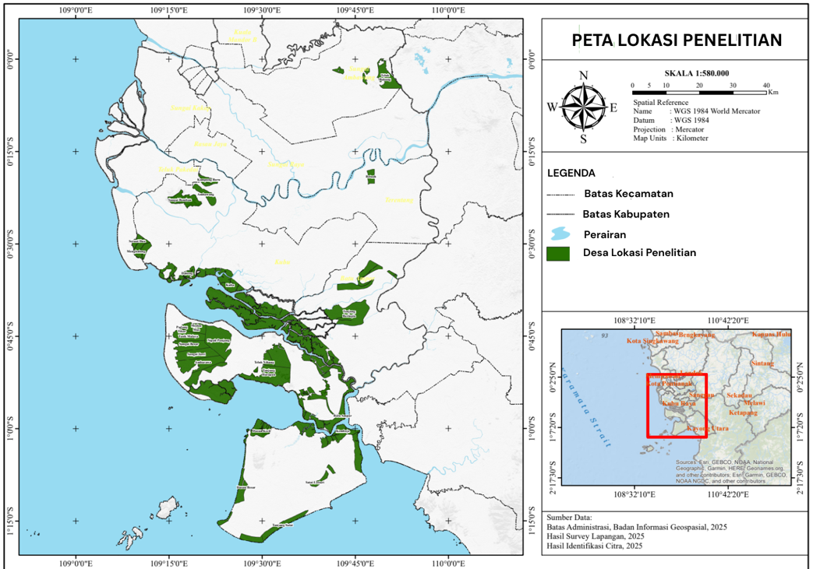
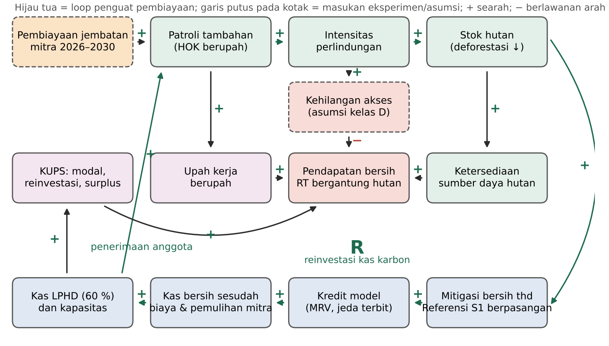
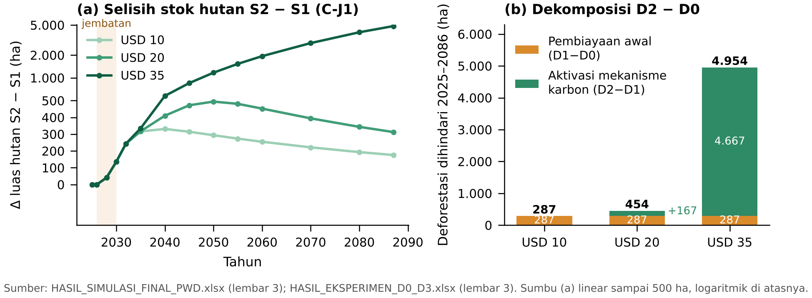
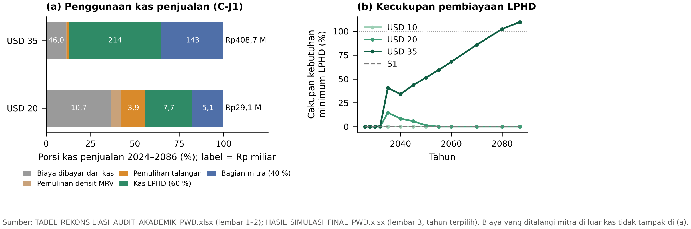
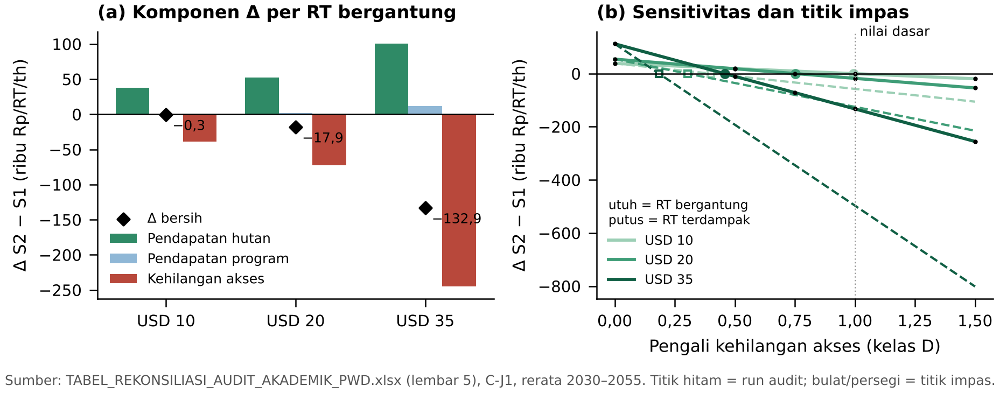
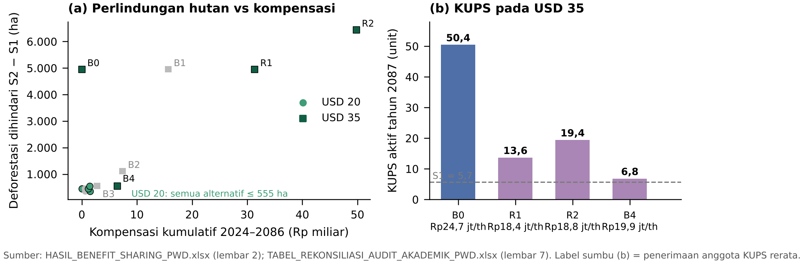
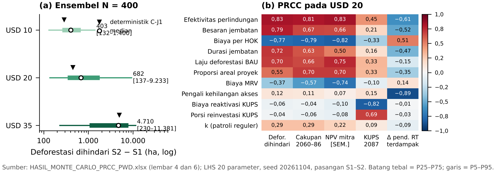

# PERHUTANAN SOSIAL DAN PERDAGANGAN KARBON SEBAGAI STRATEGI PEMBANGUNAN PERDESAAN DI KALIMANTAN BARAT

*Social Forestry and Carbon Trading as a Rural Development Strategy in West Kalimantan*

**[NAMA MAHASISWA]¹⁾, Akhmad Fauzi²⁾, Andrea Emma Pravitasari³⁾**

## ABSTRACT

Twenty-five village forests in coastal West Kalimantan hold 124,941 ha under management licences, about three quarters still forested in 2024, and carbon trading is expected to finance their protection and rural development. This study examines how carbon finance affects forest protection, the financial sustainability of village forest institutions (LPHD), employment, enterprise groups (KUPS) and household income, and benefit-sharing trade-offs. A system dynamics model (Vensim, simulated in PySD) compares two scenarios for 2024–2087: social forestry with limited financing (S1) and social forestry with bridge financing in 2026–2030 plus conservative carbon credits measured against a paired S1 reference (S2). At USD 10, 20 and 35/tCO₂e, S2 avoided 287, 454 and 4,954 ha of deforestation. Diagnostic experiments attribute all of the gain at USD 10, and 63 % at USD 20, to bridge financing; without it no credits arise. Below USD 35, LPHD received carbon cash in at most 17 of 62 years, covered about 5 % of minimum management needs at USD 20, and part of the protected forest was lost again after funding ended. Paid work rose by 0.4–17.4 full-time equivalents, but household income effects depend on an untested access-restriction assumption whose break-even multiplier is 0.46–0.99. Allocation experiments show that compensation funded from the enterprise share preserves protection only by shrinking active KUPS. Carbon trading can sustain village forests only with upfront finance, sufficient prices and explicit household safeguards.

**Keywords:** benefit sharing, bridge financing, carbon finance, social forestry, system dynamics, village forest

## PENDAHULUAN

Dua puluh lima Hutan Desa (HD) di pesisir Kalimantan Barat mencakup areal SK pengelolaan seluas 124.941 ha pada lanskap Kubu, Padang Tikar, dan Pulau Maya. Pada 2024 sekitar tiga perempat areal itu masih berhutan (94.308 ha), terutama mangrove sekunder (52.398 ha) dan hutan rawa sekunder (36.932 ha). Hutan tersebut menahan abrasi, menyimpan karbon gambut, dan menghidupi 72.516 jiwa penduduk desa pengelola. Tekanannya tidak berhenti: selama 2001–2024 kehilangan tutupan pohon bruto di dalam areal SK mencapai sekitar 17.183 ha (Hansen et al. 2013), dengan lonjakan pada kebakaran 2015–2016.

Skema Perhutanan Sosial (PS) memberi Lembaga Pengelola Hutan Desa (LPHD) hak kelola yang sah (KLHK 2021), sehingga masyarakat dapat memanfaatkan sekaligus menjaga hutan. Hak kelola tidak otomatis disertai dana. Patroli 2023–2025 (392 kegiatan pada 2023, 2.533 hari orang kerja/HOK pada 2024, dan 3.011 HOK pada 2025) dibiayai mitra proyek karbon, sedangkan operasional lembaga, pengendalian kebakaran, rehabilitasi, dan Kelompok Usaha Perhutanan Sosial (KUPS) belum memiliki sumber tetap.

Perdagangan karbon sukarela diharapkan mengisi kekosongan itu, tetapi harga kredit penghindaran deforestasi rata-rata hanya sekitar USD 6/tCO₂e pada 2024 (Ecosystem Marketplace 2025), sementara biaya pemantauan, pelaporan, dan verifikasi (MRV) bersifat tetap. Persoalan waktunya juga nyata: kredit baru terbit beberapa tahun setelah kegiatan perlindungan berjalan, sehingga patroli harus dibiayai lebih dulu dari sumber lain. Imbal jasa lingkungan efektif bila pembayarannya bersyarat dan biaya transaksinya rendah (Wunder 2005), dan dampaknya terhadap deforestasi maupun kesejahteraan cenderung kecil dan beragam (Samii et al. 2014).

Keberhasilan ekologis pun tidak otomatis menjadi manfaat ekonomi rumah tangga. Pendapatan dari lingkungan menyumbang sekitar 28 % pendapatan rumah tangga di sekitar hutan (Angelsen et al. 2014), sehingga perlindungan yang lebih ketat dapat membebani 2.144 pemegang garapan di dalam HD. Kajian di Indonesia menemukan bahwa pengelolaan berbasis masyarakat menahan deforestasi di sebagian lokasi (Santika et al. 2017), dampaknya terhadap penghidupan beragam (Santika et al. 2019), dan perluasan izin PS belum menurunkan deforestasi secara agregat (Kraus et al. 2021).

Kajian tersebut bersifat ex-post dan memisahkan PS dari pembiayaannya, sehingga hubungan antara pembiayaan awal, penerimaan karbon, keberlanjutan LPHD, dan pembagian manfaat belum ditelusuri sebagai satu sistem umpan balik. Pendekatan *system dynamics* memungkinkan umpan balik itu diikuti dalam jangka panjang (Sterman 2000) dalam kerangka sistem sosial-ekologis (Ostrom 2009). Penelitian ini bertujuan menganalisis: (1) pengaruh tambahan pembiayaan perdagangan karbon terhadap perlindungan hutan, deforestasi, dan mitigasi emisi; (2) kelayakan dan keberlanjutan pembiayaan pengelolaan HD serta kapasitas kelembagaan LPHD; (3) kesempatan kerja, perkembangan KUPS, pendapatan rumah tangga, dan risiko kehilangan akses terhadap sumber daya hutan; serta (4) alternatif pembagian manfaat, kompensasi masyarakat terdampak, dan *trade-off* antara konservasi, kelembagaan, dan ekonomi produktif. Kontribusinya adalah kerangka simulasi yang memisahkan peran pembiayaan awal dari mekanisme karbon dan menelusuri manfaatnya sampai ke LPHD, KUPS, dan rumah tangga.

## METODE PENELITIAN

### Lokasi dan Cakupan Penelitian

Penelitian dilakukan pada 25 HD di Kubu (10 HD; 32.468 ha), Padang Tikar (10 HD; 76.370 ha), dan Pulau Maya (5 HD; 16.103 ha) (Gambar 1). Hak kelola 24 HD terbit pada 2017–2020 dan HD Kemboja pada 2024. Unit analisis adalah agregat 25 HD dengan domain areal SK 124.941 ha; areal proyek karbon (111.123 ha) hanya dipakai untuk menghitung kredit. Ketergantungan pada hutan diwakili 5.328 pekerja berbasis sumber daya alam yang diperlakukan setara rumah tangga (RT bergantung), dan RT terdampak diwakili 2.144 pemegang garapan. Keduanya adalah nilai 2024 yang tumbuh 1,66 % per tahun, sehingga reratanya pada 2030–2055 menjadi 7.462 dan 3.003 RT.

### Pendekatan System Dynamics

Model disusun di Vensim dalam 16 subsistem (946 variabel) dan disimulasikan untuk 2024–2087 dengan metode Euler dan langkah waktu 0,0625 tahun. Batas sistem mencakup lima subsistem yang saling terhubung (Gambar 2). Subsistem ekologis memuat stok hutan, deforestasi, rehabilitasi, kebakaran, dan karbon biomassa; subsistem pembiayaan memuat jembatan, kredit, kas, biaya, dan pemulihan dana mitra; subsistem kelembagaan memuat kas, belanja, dan kapasitas LPHD; subsistem sosial-ekonomi memuat kerja, KUPS, dan pendapatan rumah tangga; subsistem distribusi membagi dana fleksibel LPHD ke tiap pos kegiatan. Inti model adalah loop penguat: perlindungan menurunkan deforestasi, mitigasi menghasilkan kredit, kas karbon membiayai patroli berikutnya.

### Formulasi Skenario

Dua skenario kebijakan dibandingkan (Tabel 1) dengan kondisi historis 2023–2025 yang sama, termasuk patroli yang dibiayai mitra. S1 adalah PS dengan pembiayaan terbatas: LPHD tetap mengelola HD, tetapi patroli reguler sesudah 2025 berjalan dengan tenaga sukarela pada separuh tingkat 2025 (k = 0,5; 1.506 HOK per tahun) tanpa penerimaan kredit. S2 menambahkan pembiayaan jembatan dan perdagangan karbon. Skenario lama "PS swadaya" dan "tanpa PS" tidak dipakai lagi karena data patroli menunjukkan bahwa kegiatan 2023–2025 bergantung pada dana mitra dan hak kelola telah terbit, sehingga keduanya bukan alternatif kebijakan yang realistis. Selisih S2 − S1 adalah proyeksi tambahan menurut model, bukan estimasi dampak kausal empiris. Konfigurasi D0–D3 hanya dipakai untuk memisahkan kontribusi pembiayaan awal dari mekanisme karbon, bukan sebagai empat skenario kebijakan baru.

**Tabel 1  Skenario kebijakan, eksperimen diagnostik, dan eksperimen alokasi**

| Kode | Konfigurasi | Peran dalam analisis |
|---|---|---|
| S1 | PS dengan pembiayaan terbatas; patroli reguler sukarela k = 0,5; tanpa kas karbon | Acuan; identik D0 |
| S2 (C-J1) | S1 + jembatan Rp782,86 juta/th 2026–2030 + kredit konservatif terhadap Referensi S1 berpasangan; harga USD 10, 20, 35/tCO₂e | Skenario kebijakan; identik D2 |
| C-JP | Seperti S2, jembatan setara kebutuhan patroli penuh (±Rp1,69 miliar/th) | Sensitivitas besaran jembatan |
| D1, D3 | D1: jembatan tanpa mekanisme karbon; D3: mekanisme karbon tanpa jembatan | Diagnostik atribusi, bukan skenario kebijakan |
| B0–B4, R1, R2 | Porsi dana fleksibel LPHD untuk patroli, rehabilitasi, kebakaran, KUPS, dan kompensasi | Eksperimen alokasi; selisih terhadap B0 |

Catatan: jembatan J1 setara 3.011 HOK × Rp260.000 (tingkat 2025) dan bukan komitmen aktual mitra. B0 = alokasi dasar model.

### Pembiayaan dan Mekanisme Kredit

Jembatan 2026–2030 diperlakukan sebagai asumsi eksperimen. Dana itu membiayai patroli tambahan dengan upah Rp150.000/HOK (data) dan biaya total Rp260.000/HOK (asumsi kerja yang mencakup komponen non-upah). Mitigasi dihitung terhadap Referensi S1, yaitu lintasan S1 yang dijalankan berpasangan dengan S2, setelah dikurangi kebocoran 10 % dan buffer 12 %, dengan proporsi areal proyek 0,682. Kredit diajukan dan diverifikasi berkala dengan jeda terbit tiga tahun, lalu dijual dengan laju 0,7 per tahun pada kurs Rp16.500/USD. Biaya MRV, transaksi (0,22 %), dan pajak (5 %) dibayar dari kas penjualan; kekurangannya ditalangi mitra. Bila hutan yang telah dikreditkan hilang kembali (*reversal*), debit diselesaikan dari buffer, pembatalan kredit sendiri, lalu pembelian kredit pengganti. Surplus dipakai berturut-turut untuk memulihkan defisit MRV dan talangan jembatan, kemudian dibagi 60 % kepada LPHD dan 40 % kepada mitra. Porsi 60/40 adalah usulan yang dimodelkan, bukan kesepakatan yang berlaku. Kas LPHD diinvestasikan kembali ke operasional, patroli, rehabilitasi, kebakaran, kelembagaan, dan KUPS. Kredit dalam penelitian ini adalah hasil perhitungan model, bukan kredit terverifikasi.

### Validasi dan Pengujian

Model diverifikasi dengan PySD 3.14.3 (Martin-Martinez et al. 2022) melalui uji struktur, dimensi, kondisi ekstrem, dan langkah waktu (Barlas 1996): 0 referensi tak dikenal, 0 loop aljabar, satuan konsisten pada 933/933 persamaan, dan selisih hasil antarlangkah waktu ≤ 0,37 %. Laju deforestasi BAU hasil kalibrasi memberi rasio 0,98 terhadap data periode uji 2017–2024. Dari baterai uji akhir, 39 uji lulus, satu gagal, satu belum dilakukan, dan satu dilaporkan. Uji yang gagal (K7) muncul ketika rantai Referensi S1 dihitung secara endogen di dalam S2: dana non-karbon yang dapat dipertukarkan menimbulkan galat atribusi kredit (kumulatif +163 tCO₂e, 0,05 % kredit). Karena itu seluruh hasil S2 memakai protokol berpasangan, yaitu tujuh lintasan Referensi S1 diisi dari run S1 mandiri; kesetaraannya terpenuhi pada 15/15 konfigurasi uji, 1.200/1.200 pasangan Monte Carlo, dan 91/91 run alokasi. Rekonsiliasi arus kas USD 20 dan USD 35 menutup semua identitas neraca. Uji *Units Check* dan pembandingan lintasan di Vensim native belum dilakukan, sehingga hasil berstatus terverifikasi PySD. NPV memakai diskonto 10 % dan masih berstatus sementara karena biaya pengembangan proyek belum dimasukkan.

### Analisis Ketidakpastian

Ketidakpastian diuji dengan Monte Carlo *Latin Hypercube Sampling* (N = 400, *seed* 20261104) atas 20 parameter, terutama parameter kelas D (asumsi tanpa data lokal), misalnya efektivitas perlindungan (segitiga 0,2–0,37–0,6), biaya Rp150.000–300.000/HOK, besaran dan durasi jembatan, biaya MRV, dan pengali kehilangan akses (0–1,5). Setiap sampel dijalankan berpasangan pada S1 dan S2, dan kepekaan diukur dengan *partial rank correlation coefficient* (PRCC). Hasilnya dilaporkan sebagai proporsi ensembel, yaitu persentase sampel yang memenuhi suatu kriteria di bawah distribusi asumsi, bukan probabilitas empiris.

### Eksperimen Alokasi

Tujuh alternatif membagi dana fleksibel LPHD, yaitu dana tersedia dikurangi operasional dan kelembagaan, ke patroli, rehabilitasi, kebakaran, KUPS, dan kompensasi RT terdampak. B0 adalah alokasi dasar; B1–B4 menggeser porsi patroli dan KUPS ke kompensasi; R1 mempertahankan porsi patroli, rehabilitasi, dan kebakaran B0 lalu mengambil kompensasi dari pos KUPS; R2 menaikkan patroli menjadi 50 %. Alternatif ini adalah eksperimen pembagian dana, bukan pengamatan atas kesepakatan aktual di desa.

## HASIL DAN PEMBAHASAN

### Kontribusi Perdagangan Karbon terhadap Perlindungan Hutan

Tanpa dana karbon, S1 kehilangan 28.640 ha hutan akibat deforestasi pada 2025–2086 (sekitar 474 ha per tahun pada 2030–2055), dan stok hutan turun dari 94.308 ha menjadi 82.799 ha pada 2087. S2 menahan sebagian kehilangan itu: deforestasi dihindari 287 ha pada USD 10, 454 ha pada USD 20, dan 4.954 ha pada USD 35 (Tabel 2).

**Tabel 2  Hasil utama S1 dan S2 (C-J1) menurut harga karbon, 2024–2087**

| Indikator | S1 | S2 USD 10 | S2 USD 20 | S2 USD 35 |
|---|---:|---:|---:|---:|
| Deforestasi dihindari thd S1 (ha) | – | 287 | 454 | 4.954 |
| Δ luas hutan 2087 thd S1 (ha) | – | 176 | 313 | 4.842 |
| Emisi dihindari (ribu tCO₂e) | – | 97,9 | 155,1 | 1.662,8 |
| Kredit model REDD diajukan (ribu tCO₂e) | – | 68,8 | 100,7 | 897,3 |
| Kas penjualan (Rp miliar) | – | 9,94 | 29,07 | 408,71 |
| Kas LPHD karbon (Rp miliar) | 0 | 0 | 7,69 | 214,33 |
| Tahun dengan kas LPHD > 0 (dari 62) | 0 | 0 | 17 | 55 |
| Cakupan kebutuhan minimum LPHD 2030–2055 / 2060–2086 (%) | 0 / 0 | 0 / 0 | 5,2 / 0,0 | 38,1 / 90,5 |
| Defisit MRV ditalangi mitra, 2087 (Rp miliar) | – | 18,95 | 15,20 | 0 |
| NPV mitra inkremental [SEMENTARA] (Rp miliar) | – | −2,82 | −0,27 | 6,66 |
| Kapasitas LPHD 2087 (0–1) | 0,50 | 0,50 | 0,50 | 0,87 |
| Kerja berupah 2030–2055 / 2060–2086 (FTE) | 0 / 0 | 0,4 / 0 | 2,7 / 0 | 17,4 / 39,5 |
| KUPS aktif 2087 (unit) | 5,7 | 5,7 | 6,1 | 50,4 |
| Penerimaan anggota KUPS (Rp juta/th) | 15,8 | 15,8 | 17,1 | 24,7 |
| Δ pendapatan bersih RT bergantung (ribu Rp/RT/th) | – | −0,3 | −17,9 | −132,9 |

Sumber: HASIL_SIMULASI_FINAL_PWD.xlsx (lembar 1–2). Nilai sosial-ekonomi adalah rerata 2030–2055 kecuali disebut lain. Pada C-JP deforestasi dihindari 686, 1.338, dan 7.487 ha. Kredit model bukan kredit terverifikasi; FTE bukan jumlah orang; kas LPHD adalah dana kolektif, bukan pendapatan rumah tangga.

Eksperimen diagnostik memperlihatkan bahwa tambahan perlindungan itu tidak seluruhnya berasal dari penjualan kredit (Gambar 3b). Kontribusi pembiayaan awal (D1 − D0) bernilai 287 ha pada semua harga, 196 ha di antaranya terjadi pada 2025–2030. Kontribusi bersih aktivasi mekanisme perdagangan karbon setelah pembiayaan awal (D2 − D1) bernilai 0 ha pada USD 10, 167 ha pada USD 20, dan 4.667 ha pada USD 35. Porsi pembiayaan awal dalam paket lengkap menjadi 100 %, 63 %, dan 6 %, dan pada USD 20 berkisar 8–100 % antarvariasi asumsi. Konfigurasi D3 (mekanisme karbon tanpa jembatan) tidak menghasilkan kredit sama sekali, tetapi tetap menanggung biaya MRV Rp22,8 miliar. Penyebabnya terletak pada aturan kredit konservatif: hanya mitigasi di atas Referensi S1 yang diakui, dan tanpa dana di luar penjualan kredit tidak ada kegiatan di atas S1. Dalam kerangka kredit ini, mekanisme karbon memerlukan pembiayaan awal agar dapat berjalan.

Lintasan pada Gambar 3a memperlihatkan risiko non-permanensi. Pada USD 10, selisih luas hutan mencapai 331 ha pada 2040 lalu menyusut menjadi 176 ha pada 2087; pada USD 20 puncaknya 494 ha pada 2050 dan tersisa 313 ha. Hutan yang diselamatkan jembatan kembali menghadapi laju deforestasi per hektare yang sama setelah pembiayaan berhenti, sehingga sebagian mitigasi hilang dan memicu kewajiban *reversal* (biaya kredit pengganti Rp2,84 miliar pada USD 20).

Dalam ensembel Monte Carlo (Gambar 7a), deforestasi dihindari bernilai positif pada 100 % sampel di ketiga harga, dengan median 403 ha [P5–P95: 132–1.400] pada USD 10, 682 ha [137–9.233] pada USD 20, dan 4.710 ha [230–11.381] pada USD 35. Manfaat karbon bersih yang tidak turun lebih dari 10 % dari puncaknya hanya ditemukan pada 0,5 %, 23,8 %, dan 78,3 % sampel. PRCC pada USD 20 menempatkan efektivitas perlindungan (+0,83), besaran jembatan (+0,79), biaya per HOK (−0,77), durasi jembatan (+0,72), dan laju deforestasi BAU (+0,70) sebagai penentu utama, sedangkan k hanya +0,29 (Gambar 7b). Efektivitas 0,37 diambil dari hutan komunitas di Nepal (Oldekop et al. 2019), dan di Indonesia efek serupa hanya muncul di sebagian lokasi (Santika et al. 2017; Kraus et al. 2021). Bagi perencanaan desa, tambahan perlindungan lebih ditentukan oleh dana yang tersedia sebelum kredit terbit dan oleh mutu patroli daripada oleh keberadaan pasar karbon.

### Keberlanjutan Pembiayaan LPHD

Urutan arus kas menjelaskan mengapa LPHD terlambat menerima dana. Kas penjualan pertama masuk pada 2029, tetapi surplusnya lebih dulu menutup defisit MRV yang ditalangi mitra sejak 2024, lalu talangan jembatan Rp3,91 miliar, baru kemudian dibagi 60/40. Kas LPHD pertama karena itu baru datang pada 2034 (USD 20) dan 2032 (USD 35), dan tidak pernah datang pada USD 10.

Pada USD 20, kas penjualan Rp29,07 miliar habis untuk biaya yang dibayar dari kas (Rp10,69 miliar), pemulihan defisit (Rp1,65 miliar), pemulihan talangan (Rp3,91 miliar), kas LPHD (Rp7,69 miliar), dan bagian mitra (Rp5,12 miliar) (Gambar 4a). Total biaya bersama mencapai Rp27,55 miliar, dan Rp16,85 miliar di antaranya ditalangi mitra, terutama pada 2051–2086 ketika MRV tetap berjalan tanpa kredit baru. Arus kas mitra nominal S2 − S1 menjadi −Rp10,08 miliar, padahal NPV mitra inkremental [SEMENTARA] hanya −Rp0,27 miliar karena defisitnya jatuh jauh di masa depan dan terdiskonto. Pada USD 35, kas penjualan Rp408,71 miliar menutup biaya Rp47,58 miliar, menghasilkan kas LPHD Rp214,33 miliar dan arus kas mitra nominal +Rp142,89 miliar (NPV +Rp6,66 miliar).

Kecukupan kelembagaan tertinggal jauh di belakang kelayakan proyek. NPV inkremental proyek [SEMENTARA] sudah positif pada USD 20 (+Rp1,75 miliar), tetapi kas LPHD hanya mengalir 17 dari 62 tahun dan menutup rata-rata 5,2 % kebutuhan minimum (operasional, patroli tambahan, dan pengendalian kebakaran) pada 2030–2055, lalu 0 % sesudah 2060 (Gambar 4b). Pada USD 35 kebutuhan itu tertutup penuh selama 8 tahun dan kapasitas LPHD naik dari 0,50 menjadi 0,87. Proporsi ensembel menunjukkan pola yang sama: kas LPHD masih mengalir pada 2075–2086 hanya pada 0,5 %, 22,3 %, dan 74,0 % sampel, sedangkan NPV mitra positif pada 4,3 %, 46,8 %, dan 88,8 % sampel.

Temuan ini menyerupai pengalaman imbal jasa lingkungan lain, yaitu pembayaran tidak menutup biaya kelembagaan bila biaya transaksi dan pemantauannya tinggi (Wunder 2005; Samii et al. 2014). Bagi desa, dana karbon dalam kisaran harga rendah sampai menengah lebih tepat diposisikan sebagai pelengkap dana pengelolaan, bukan pengganti. Kas LPHD juga harus dibedakan dari uang yang diterima rumah tangga: kas bruto adalah penerimaan penjualan, kas bersih adalah sisa setelah biaya dan pemulihan, kas LPHD adalah dana kolektif yang dibelanjakan lembaga, dan hanya sebagian kecil sampai ke rumah tangga sebagai upah atau bagian surplus KUPS.

### Kesempatan Kerja, KUPS, dan Pendapatan Rumah Tangga

Manfaat ekonomi yang paling langsung dari S2 berupa kerja berupah. Patroli reguler sukarela (1.506 HOK per tahun atau 5,0 FTE) sama pada S1 dan S2; seluruh tambahan di S2 adalah kerja berupah untuk patroli, penanaman, dan pengendalian kebakaran. Tambahannya 0,4 FTE pada USD 10, 2,7 FTE pada USD 20, dan 17,4 FTE pada USD 35 (rerata 2030–2055). Sesudah 2060 kerja tambahan hanya bertahan pada USD 35 (39,5 FTE). KUPS bergerak lebih lambat. Di S1, KUPS aktif turun dari 33,4 unit pada 2026 menjadi 5,7 unit pada 2087 karena biaya reaktivasi dan porsi reinvestasi tidak cukup mempertahankan usaha. S2 hanya menambah 0,3 unit KUPS dan Rp1,4 juta penerimaan anggota per tahun pada USD 20, tetapi 44,7 unit dan Rp9,0 juta per tahun pada USD 35.

Pendapatan rumah tangga dibentuk oleh tiga komponen yang arahnya berlawanan (Gambar 5a). Perlindungan memperbaiki ketersediaan sumber daya sehingga pendapatan hutan naik (+Rp52.266 per RT bergantung per tahun pada USD 20), dan pendapatan program naik kecil (+Rp2.086). Model juga memuat kehilangan akses yang meningkat bersama intensitas perlindungan (−Rp72.261 pada pengali dasar 1). Pada pengali itu, pendapatan bersih RT bergantung (Rp41,21 juta per tahun di S1) bergeser −Rp270, −Rp17.909, dan −Rp132.944 per tahun pada USD 10, 20, dan 35, sedangkan RT terdampak bergeser −Rp57.610, −Rp125.222, dan −Rp496.878. Secara agregat pada USD 20, uang tunai yang sampai ke rumah tangga (upah Rp4,65 miliar dan bagian KUPS Rp0,05 miliar kumulatif) lebih kecil daripada tambahan kehilangan akses yang diasumsikan (Rp16,32 miliar).

Arah dampak itu tidak dapat dibaca sebagai penurunan kesejahteraan akibat perdagangan karbon. PS memberi akses kelola yang sah, dan patroli tidak dengan sendirinya membatasi hak pemanfaatan; kehilangan akses dalam model adalah mekanisme asumsi kelas D yang belum divalidasi di lapangan. Gambar 5b memperlihatkan bahwa pendapatan bersih RT bergantung tidak berubah bila pengali kehilangan akses sebesar 0,99 (USD 10), 0,75 (USD 20), atau 0,46 (USD 35); bagi RT terdampak titik impasnya 0,40, 0,30, dan 0,18. Pada pengali 0, selisih pendapatan RT bergantung pada USD 20 berbalik menjadi +Rp54.352. Pengali kehilangan akses juga merupakan penentu terkuat selisih pendapatan dalam ensembel (PRCC −0,89), dan pendapatan RT bergantung naik hanya pada 47,5 % sampel di USD 20. Jadi, dampak pendapatan rumah tangga bergantung pada besarnya kehilangan akses yang benar-benar terjadi dan pada manfaat ekonomi yang benar-benar diterima. Bagi perencanaan desa, kerja berupah dan KUPS adalah saluran manfaat yang perlu dijaga, sedangkan besaran kehilangan akses perlu diukur sebelum dijadikan dasar kebijakan kompensasi.

### Distribusi Manfaat dan Trade-off Pembangunan Perdesaan

Pada USD 10 semua alternatif alokasi identik karena kas LPHD nol, dan pada USD 20 kompensasi kumulatif tertinggi hanya Rp1,48 miliar; pembahasan karena itu memakai USD 35 untuk memperlihatkan *trade-off*, bukan sebagai patokan harga (Tabel 3; Gambar 6).

**Tabel 3  Alternatif alokasi kunci pada S2 USD 35**

| Indikator | B0 | R1 | R2 | B4 |
|---|---:|---:|---:|---:|
| Deforestasi dihindari thd S1 (ha) | 4.954 | 4.954 | 6.443 | 553 |
| Kas LPHD karbon (Rp miliar) | 214,3 | 214,3 | 293,2 | 24,4 |
| Kapasitas LPHD 2087 (0–1) | 0,87 | 0,87 | 0,93 | 0,50 |
| KUPS aktif 2087 (unit) | 50,4 | 13,6 | 19,4 | 6,8 |
| Penerimaan anggota KUPS (Rp juta/th) | 24,7 | 18,4 | 18,8 | 19,9 |
| Modal usaha KUPS 2087 (Rp juta) | 141,3 | 1,2 | 35,3 | 0,4 |
| Kompensasi kumulatif (Rp miliar) | 0 | 31,4 | 49,8 | 6,4 |
| Kompensasi thd kehilangan akses total (%) | 0 | 12,4 | 12,5 | 18,9 |
| Kehilangan akses per RT terdampak (ribu Rp/th) | 837 | 837 | 1.144 | 452 |
| Pendapatan bersih RT terdampak (Rp juta/th) | 40,58 | 40,68 | 40,45 | 41,00 |

Sumber: HASIL_BENEFIT_SHARING_PWD.xlsx (lembar 2) dan TABEL_REKONSILIASI_AUDIT_AKADEMIK_PWD.xlsx (lembar 7). Rerata 2030–2055 kecuali disebut lain.

R1 mempertahankan perlindungan B0 karena konstruksinya: porsi efektif patroli, rehabilitasi, dan kebakaran sama dengan B0 (30 %, 15 %, dan 10 % belanja), sedangkan kompensasi 15 % diambil dari pos KUPS yang turun dari 20 % menjadi 5 %. Biaya peluangnya jatuh pada usaha produktif: KUPS aktif 2087 turun dari 50,4 menjadi 13,6 unit (−73 %), penerimaan anggota dari Rp24,7 juta menjadi Rp18,4 juta per tahun, dan modal usaha dari Rp141,3 juta menjadi Rp1,2 juta. Sebagai gantinya, RT terdampak menerima kompensasi kumulatif Rp31,4 miliar, sekitar Rp103.466 per RT per tahun, yang menutup 12,4 % kehilangan akses yang diasumsikan.

Alternatif lain memperjelas pilihan yang dihadapi desa. R2 memberi perlindungan terbesar (+1.490 ha di atas B0) dan kapasitas LPHD tertinggi, tetapi intensitas perlindungan yang lebih tinggi juga menaikkan kehilangan akses per RT terdampak menjadi Rp1,14 juta per tahun, sehingga pendapatan RT terdampak paling rendah. B4 memberi rasio kompensasi tertinggi (18,9 %), namun deforestasi dihindari turun menjadi 553 ha dan kas LPHD menyusut menjadi Rp24,4 miliar karena patroli yang lebih sedikit menghasilkan kredit lebih sedikit. Pendapatan RT terdampak tertinggi justru muncul pada B4, karena kehilangan akses yang diasumsikan ikut turun bersama intensitas perlindungan. Tidak ada alternatif yang unggul pada semua ukuran, dan R1 bukan alokasi optimal; R1 hanya menunjukkan bahwa kompensasi dapat dibiayai tanpa mengurangi patroli bila desa bersedia mengorbankan pertumbuhan KUPS. Pembagian manfaat pada akhirnya adalah keputusan kelembagaan tentang siapa yang menanggung biaya konservasi; tinjauan global atas hutan komunitas juga menemukan bahwa hasil sosial dan ekologis tidak selalu bergerak searah (Hajjar et al. 2021).

### Keterbatasan Penelitian

Hasil berlaku untuk agregat 25 HD dan merupakan proyeksi model. Parameter kelas D (biaya total Rp260.000/HOK, besaran dan durasi jembatan, pengali kehilangan akses, RT bergantung sebagai proksi 5.328 pekerja, parameter KUPS, dan k) menentukan besaran dan sebagian arah hasil. Aturan MRV, penyelesaian *reversal*, prioritas pemulihan, dan porsi 60/40 adalah aturan model tanpa dasar kontrak. Hasil bergantung pada protokol Referensi S1 berpasangan, belum diverifikasi di Vensim native, dan NPV masih sementara. Penelitian tidak mengukur kemiskinan atau ketimpangan.

## SIMPULAN DAN SARAN

### Simpulan

Perdagangan karbon menambah perlindungan hutan di atas S1 pada semua harga yang diuji (287–4.954 ha deforestasi dihindari pada USD 10–35), tetapi pada USD 10–20 sebagian besar tambahan itu berasal dari pembiayaan awal, dan sebagian mitigasi hilang kembali setelah pembiayaan berhenti. Tanpa pembiayaan awal, kredit konservatif tidak terbentuk.

Pembiayaan LPHD baru berkelanjutan bila harga cukup tinggi untuk menutup biaya MRV dan pemulihan dana mitra (pada USD 35 kas LPHD mengalir 55 dari 62 tahun); pada USD ≤ 20 kelayakan proyek tidak diikuti kecukupan dana lembaga, dan mitra menanggung defisit MRV jangka panjang.

Manfaat sosial-ekonomi terutama berupa kerja berupah dan, pada harga tinggi, KUPS yang bertahan; dampak terhadap pendapatan rumah tangga bersyarat pada kehilangan akses yang belum tervalidasi (titik impas 0,46–0,99 untuk RT bergantung).

Pilihan pembagian manfaat memindahkan beban antara konservasi, kompensasi, kelembagaan, dan usaha produktif: kompensasi dari pos KUPS mempertahankan perlindungan tetapi mengecilkan KUPS, sedangkan pemotongan patroli mengorbankan hutan dan dana LPHD.

### Saran

Rekomendasi yang langsung didukung simulasi: (1) mitra pembiayaan perlu menyiapkan dana jembatan dan menyepakati status hibah atau talangannya sebelum proyek berjalan, karena tanpa dana itu kredit tidak terbentuk; (2) mitra dan LPHD perlu menetapkan aturan penghentian atau penyesuaian MRV bila penjualan tidak menutup biaya, agar defisit tidak menumpuk; (3) LPHD perlu mempertahankan porsi patroli minimal setara B0 dan menjaga porsi KUPS bila kompensasi diberikan, karena kompensasi dari pos KUPS menurunkan usaha produktif.

Rekomendasi bagi pemerintah: dana karbon pada harga rendah sampai menengah perlu dipadukan dengan dana desa, anggaran daerah, dan program restorasi untuk menutup kebutuhan minimum LPHD; harga USD 35 di sini bukan patokan harga karbon. Rekomendasi yang memerlukan data tambahan: survei rumah tangga tentang pembatasan akses, biaya patroli non-upah, efektivitas patroli lokal, dan catatan usaha KUPS perlu dikumpulkan sebelum besaran kompensasi ditetapkan.

## DAFTAR PUSTAKA

Angelsen A, Jagger P, Babigumira R, Belcher B, Hogarth NJ, Bauch S, Börner J, Smith-Hall C, Wunder S. 2014. Environmental income and rural livelihoods: a global-comparative analysis. World Dev. 64(Suppl 1):S12–S28. doi:10.1016/j.worlddev.2014.03.006.

Barlas Y. 1996. Formal aspects of model validity and validation in system dynamics. Syst Dyn Rev. 12(3):183–210.

Ecosystem Marketplace. 2025. State of the Voluntary Carbon Market 2025: Meeting the Moment. Washington DC (US): Forest Trends.

Hajjar R, Oldekop JA, Cronkleton P, Newton P, Russell AJM, Zhou W. 2021. A global analysis of the social and environmental outcomes of community forests. Nat Sustain. 4(3):216–224. doi:10.1038/s41893-020-00633-y.

Hansen MC, Potapov PV, Moore R, Hancher M, Turubanova SA, Tyukavina A, Thau D, Stehman SV, Goetz SJ, Loveland TR, et al. 2013. High-resolution global maps of 21st-century forest cover change. Science. 342(6160):850–853. doi:10.1126/science.1244693.

[KLHK] Kementerian Lingkungan Hidup dan Kehutanan. 2021. Peraturan Menteri Lingkungan Hidup dan Kehutanan Nomor 9 Tahun 2021 tentang Pengelolaan Perhutanan Sosial. Jakarta (ID): KLHK.

Kraus S, Liu J, Koch N, Fuss S. 2021. No aggregate deforestation reductions from rollout of community land titles in Indonesia yet. Proc Natl Acad Sci USA. 118(43):e2100741118. doi:10.1073/pnas.2100741118.

Martin-Martinez E, Samsó R, Houghton J, Solé J. 2022. PySD: system dynamics modeling in Python. J Open Source Softw. 7(78):4329. doi:10.21105/joss.04329.

Oldekop JA, Sims KRE, Karna BK, Whittingham MJ, Agrawal A. 2019. Reductions in deforestation and poverty from decentralized forest management in Nepal. Nat Sustain. 2(5):421–428. doi:10.1038/s41893-019-0277-3.

Ostrom E. 2009. A general framework for analyzing sustainability of social-ecological systems. Science. 325(5939):419–422. doi:10.1126/science.1172133.

Samii C, Lisiecki M, Kulkarni P, Paler L, Chavis L, Snilstveit B, Vojtkova M, Gallagher E. 2014. Effects of payment for environmental services (PES) on deforestation and poverty in low and middle income countries: a systematic review. Campbell Syst Rev. 10(1):1–95. doi:10.4073/csr.2014.11.

Santika T, Meijaard E, Budiharta S, Law EA, Kusworo A, Hutabarat JA, Indrawan TP, Struebig M, Raharjo S, Huda I, et al. 2017. Community forest management in Indonesia: avoided deforestation in the context of anthropogenic and climate complexities. Glob Environ Change. 46:60–71. doi:10.1016/j.gloenvcha.2017.08.002.

Santika T, Wilson KA, Budiharta S, Kusworo A, Meijaard E, Law EA, Friedman R, Hutabarat JA, Indrawan TP, St John FAV, Struebig MJ. 2019. Heterogeneous impacts of community forestry on forest conservation and poverty alleviation: evidence from Indonesia. People Nat. 1(2):204–219. doi:10.1002/pan3.25.

Sterman JD. 2000. Business Dynamics: Systems Thinking and Modeling for a Complex World. Boston (US): Irwin/McGraw-Hill.

Wunder S. 2005. Payments for Environmental Services: Some Nuts and Bolts. CIFOR Occasional Paper No. 42. Bogor (ID): CIFOR.

---

¹⁾ Mahasiswa S2 Program Studi Ilmu Perencanaan Pembangunan Wilayah dan Perdesaan, Fakultas Ekonomi dan Manajemen, IPB University
²⁾ Prof. Dr. Ir. Akhmad Fauzi, M.Sc., Ketua Komisi Pembimbing, Dosen Program Studi Ilmu Perencanaan Pembangunan Wilayah dan Perdesaan, IPB University
³⁾ Prof. Dr. Andrea Emma Pravitasari, S.P., M.Si., Anggota Komisi Pembimbing, IPB University
